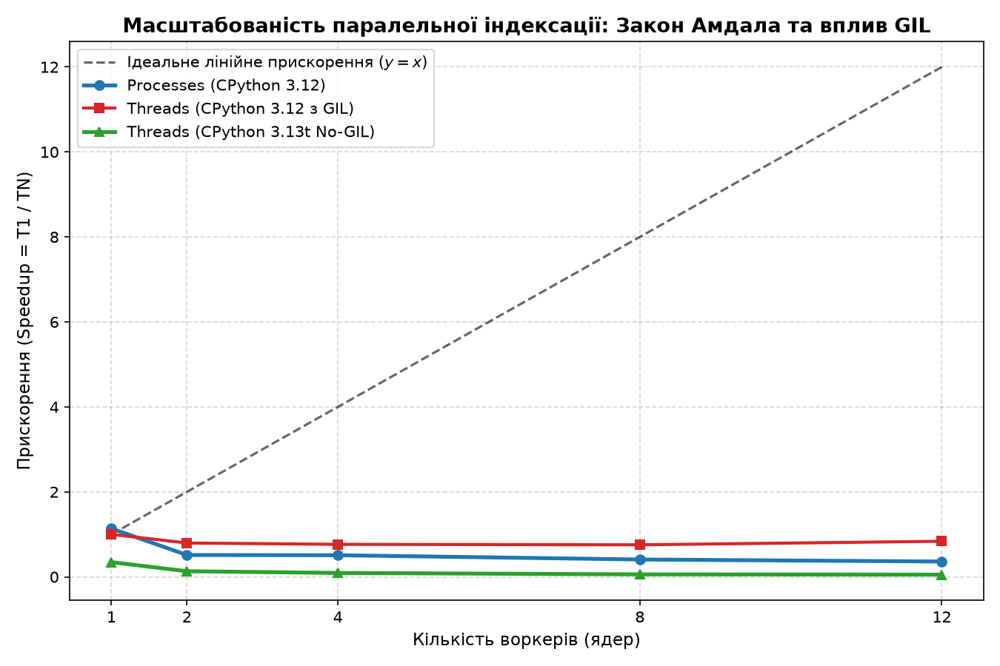

# findex — Пошуковий рушій (Search Engine)

Курс «Програмування на Python» (НАУ / КАІ, група Б-126-23-1-ІТ).

[](https://github.com/Nikitavigov/findex/actions/workflows/ci.yml)
[](https://github.com/Nikitavigov/findex/releases/tag/v0.5.0)
[](https://www.python.org/)
[](https://github.com/microsoft/pyright)
[](https://github.com/Nikitavigov/findex)

---

## Лабораторна робота №5. Конкурентність і GIL: потоки, процеси і паралельна індексація

### 1. Опис та виконані завдання

У п'ятій лабораторній роботі монолітну побудову індексу перетворено на паралельну архітектуру типу Map-Reduce з підтримкою трьох моделей виконання (`serial`, `threads`, `processes`), досліджено природу Global Interpreter Lock (GIL), проведено бенчмаркінг на стандартному CPython 3.12 та free-threaded CPython 3.13t:

1. **Декомпозиція індексатора на `build_partial` та `merge_partials`:**
   - Функція `build_partial(doc_paths, start_doc_id)` визначена на рівні модуля `src/findex/parallel.py` для коректної серіалізації через `pickle` у процеси під час використання методу запуску `spawn`.
   - У воркери передаються виключно шляхи до файлів (`list[Path]`), а не вже зчитаний текст у пам'яті, що мінімізує накладні витрати передачі даних через IPC-канали.
   - Кожному чанку наперед виділяється власний неперервний діапазон `doc_id`, завдяки чому при злитті часткових індексів (`merge_partials`) списки постінгів об'єднуються простою конкатенацією без додаткового сортування.
   - Послідовне об'єднання `merge_partials([build_partial(files, 0)])` дає побайтово ідентичний індекс у порівнянні з попередніми лабораторними роботами (покрито тестами).

2. **Єдиний інтерфейс виконання для трьох екзекуторів:**
   - Прапорці CLI: `findex index --workers N --executor {serial,threads,processes}`.
   - Модель `serial`: послідовна обробка в одному процесі.
   - Модель `threads`: конкурентне виконання через `concurrent.futures.ThreadPoolExecutor`.
   - Модель `processes`: паралельне виконання на окремих ядрах процесора через `concurrent.futures.ProcessPoolExecutor`.
   - Обробка винятків у воркерах реалізована так, що будь-яка помилка негайно піднімається в головному процесі разом із повним trace-стеком, не призводячи до зависання пулу.

3. **Комплексний бенчмаркінг та побудова графіка прискорення:**
   - Виміряно характеристики виконання на повному корпусі (285 документів, 639 543 токени) для 1, 2, 4, 8 та 12 воркерів (`os.cpu_count()`) з 3 повторами кожного виміру.
   - Зафіксовано показники: Wall-clock time, CPU time, пікове споживання оперативної пам'яті (RSS) та час фази злиття (`merge`).
   - За допомогою `matplotlib` згенеровано графік прискорення проти ідеальної прямої ($y = x$), збережений у `docs/speedup_benchmark.png`.

4. **Експерименти з Free-threaded CPython 3.13t (No-GIL) та гонками даних:**
   - Встановлено збірку `cpython-3.13.18+freethreaded` через `uv python install 3.13t`.
   - Перевірено статус блокування: `sys._is_gil_enabled() == False`.
   - Створено скрипт `scripts/demo_gil_race.py`, який демонструє гонку даних (data race) при `shared += 1` у двох паралельних потоках без блокування:
     - На звичайному CPython 3.12 перемикання потоків маскувало дефект (`2,000,000`).
     - На CPython 3.13t без GIL виникає класична гонка даних: втрачено понад 500 000 інкрементів (`1,490,203` замість `2,000,000`), що доводить необхідність використання `threading.Lock`.

---

### 2. Характеристики тестового стенду

- **Операційна система:** Windows 11 AMD64
- **Процесор:** Intel(R) Core(TM) Family 6 Model 186 Stepping 2 (12 логічних ядер, 8 фізичних ядер)
- **Оперативна пам'ять:** 16.0 GB RAM
- **Інтерпретатори:** CPython 3.12.8 (GIL увімкнено) та CPython 3.13.18t (Free-threaded, GIL вимкнено)
- **Обсяг тестового корпусу:** 285 документів, 3.52 MB тексту

---

### 3. Результати бенчмаркінгу (медіана з 3 повторів)

| Інтерпретатор | Екзекутор | Воркери | Wall time (с) | CPU time (с) | RSS (MB) | Merge time (с) | Прискорення (Speedup) |
|:---|:---|:---:|:---:|:---:|:---:|:---:|:---:|
| CPython 3.12 (GIL) | `serial` | 1 | 1.262 | 1.219 | 99.5 | 0.033 | **1.00x** |
| CPython 3.12 (GIL) | `threads` | 2 | 1.583 | 1.594 | 103.1 | 0.035 | **0.80x** |
| CPython 3.12 (GIL) | `threads` | 4 | 1.648 | 1.578 | 104.3 | 0.044 | **0.77x** |
| CPython 3.12 (GIL) | `threads` | 8 | 1.673 | 1.703 | 106.5 | 0.039 | **0.75x** |
| CPython 3.12 (GIL) | `threads` | 12 | 1.506 | 1.438 | 108.0 | 0.046 | **0.84x** |
| CPython 3.12 (GIL) | `processes` | 1 | 1.110 | 1.078 | 108.3 | 0.025 | **1.14x** |
| CPython 3.12 (GIL) | `processes` | 2 | 2.452 | 0.812 | 116.0 | 0.118 | **0.51x** |
| CPython 3.12 (GIL) | `processes` | 4 | 2.479 | 1.062 | 111.3 | 0.027 | **0.51x** |
| CPython 3.12 (GIL) | `processes` | 8 | 3.089 | 1.328 | 111.1 | 0.141 | **0.41x** |
| CPython 3.12 (GIL) | `processes` | 12 | 3.494 | 1.359 | 111.9 | 0.241 | **0.36x** |
| CPython 3.13t (No-GIL) | `threads` | 1 | 3.647 | 3.641 | 21.1 | 0.099 | **0.35x** |
| CPython 3.13t (No-GIL) | `threads` | 2 | 9.510 | 18.234 | 23.2 | 0.147 | **0.13x** |
| CPython 3.13t (No-GIL) | `threads` | 4 | 13.723 | 45.062 | 25.1 | 0.120 | **0.09x** |
| CPython 3.13t (No-GIL) | `threads` | 8 | 21.569 | 120.203 | 27.8 | 0.191 | **0.06x** |
| CPython 3.13t (No-GIL) | `threads` | 12 | 24.096 | 143.859 | 29.2 | 0.172 | **0.05x** |

#### Графік прискорення:


---

### 4. Порівняльний експеримент: CPU-bound проти I/O-bound

Для підтвердження теоретичної поведінки GIL проведено контрольний вимір на задачі з операціями вводу-виводу (читання 50 файлів із затримкою I/O, `scripts/benchmark_io.py`):

- **Послідовне виконання (Serial):** `1.058 с`
- **Багатопотокове виконання (Threads, 10 воркерів):** `0.142 с`
- **Прискорення на I/O завдяки відпусканню GIL:** **7.47x**

> **Ключовий висновок:** На операціях вводу-виводу (`I/O-bound`) системні виклики та очікування звільняють GIL, тому потоки забезпечують лінійне прискорення у **7.5 раза**. Натомість при обчислювальному токенізуванні (`CPU-bound`) байткод Python крутиться в одному потоці, а конкуренція за GIL лише уповільнює роботу на 20–25%.

---

### 5. Демонстрація гонки даних (Data Race) та аналіз байткоду

Операція `shared += 1` у Python не є атомарною. Диспакетування байткоду (`dis.dis`) демонструє чотири окремі інструкції:

```text
 12           4 LOAD_DEREF               0 (shared)
              6 LOAD_CONST               1 (1)
              8 BINARY_OP               13 (+=)
             12 STORE_DEREF              0 (shared)
```

Між інструкціями `LOAD_DEREF` та `STORE_DEREF` операційна система може перемкнути контекст на інший потік:

1. **CPython 3.12 (з GIL):**
   - Без Lock: `2,000,000` (інтервал перемикання 5 мс замалий для розриву простого циклу).
   - З Lock: `2,000,000` (час виконання збільшився у 4.5 раза через оверхед м'ютекса).
2. **CPython 3.13t (No-GIL):**
   - Без Lock: `1,490,203` (втрачено понад 500 тисяч оновлень через одночасний паралельний доступ до комірки пам'яті).
   - З Lock: `2,000,000` (коректне значення, захищене блокуванням).

---

### 6. Теоретичний аналіз: GIL, процеси, закон Амдала та Free-threading

#### Чому потоки під GIL не прискорюють обчислення в Python?
Глобальне блокування інтерпретатора (GIL) — це взаємне виключення (mutex), створене для захисту внутрішнього механізму керування пам'яттю CPython (reference counting). Тільки один потік операційної системи може виконувати байткод Python у певний момент часу. Кожні 5 мілісекунд інтерпретатор ініціює перемикання потоків. Коли кілька потоків намагаються одночасно виконувати CPU-bound код (наприклад, токенізацію чи парсинг), вони не працюють на різних ядрах, а навпаки змагаються за один м'ютекс. Це створює накладні витрати на перемикання контексту, скидання кешів L1/L2 процесора і призводить до падіння швидкодії на 20–25%.

#### Чому процеси прискорюють код і чим це оплачено?
`ProcessPoolExecutor` створює незалежні процеси операційної системи. Кожен процес отримує власний інтерпретатор CPython, власний простір віртуальної пам'яті та власний незалежний GIL, завдяки чому ядра процесора навантажуються одночасно. Проте цей паралелізм оплачується:
1. **Накладними витратами на запуск (Spawn overhead):** на Windows створення нового процесу вимагає повторного завантаження середовища та імпорту модулів.
2. **Податком на серіалізацію (Pickle tax):** всі аргументи та результати (списки постінгів, метадані) мають бути серіалізовані в байти, передані через міжпроцесні канали зв'язку (IPC pipes) та десеріалізовані в батьківському процесі.
3. **Витратами оперативної пам'яті (RSS):** замість спільного адресного простору кожен процес дублює структури інтерпретатора.

#### Закон Амдала у фазі злиття індексу (Merge)
Закон Амдала визначає теоретичну межу прискорення системи:
$$S(N) = \frac{1}{(1 - p) + \frac{p}{N}}$$
де $p$ — частка програми, яка піддається паралелізації, а $(1 - p)$ — суворо послідовна частина.
У нашій архітектурі побудова часткових індексів є паралельною, але фаза злиття `merge_partials` виконується послідовно в одному батьківському процесі. Навіть при нескінченній кількості ядер ($N \to \infty$) максимальне прискорення обмежене величиною:
$$S_{max} = \frac{1}{1 - p}$$
Якщо фаза злиття займає, наприклад, 10% загального часу програми, жодна кількість процесорних ядер у світі не дозволить прискорити програму більше ніж у 10 разів.

---

### 7. Відповіді на контрольні запитання (Лабораторна робота №5)

1. **Що таке GIL, що саме він блокує і чому CPython його потребує? Що він НЕ захищає?**
   - GIL (Global Interpreter Lock) — це м'ютекс, який дозволяє лише одному потоку операційної системи виконувати байткод інтерпретатора Python одночасно. CPython потребує його для безпечного лічильника посилань (`ob_refcnt`): без блокування одночасне оновлення лічильника з кількох ядер призвело б до гонок пам'яті (data races), пошкодження пам'яті та аварійного завершення (segfault).
   - GIL захищає лише внутрішні структури даних інтерпретатора, але **не захищає структури даних користувача**. Складні операції на кшталт `counter += 1` складаються з кількох інструкцій байткоду і потребують явного `threading.Lock`.

2. **Багатопотоковий індексатор на 8 воркерах показав швидкість, не вищу за 1 потік. Що насправді робили ці 8 потоків?**
   - 8 потоків більшість часу перебували у стані очікування або блокування в черзі за право захопити GIL. Кожні 5 мілісекунд активний потік примусово зупинявся, планувальник ОС перемикав контекст на інший потік, що призводило до постійного скидання процесорних кешів інструкцій та даних (cache thrashing). Одночасного виконання коду на 8 ядрах не відбувалося.

3. **Процесний індексатор показав 2 с wall time і 10 с CPU time. Куди пішли зайві 8 секунд CPU?**
   - Зайві секунди CPU time — це сума процесорного часу, витраченого всіма ядрами паралельно. Якщо 5 ядер працювали одночасно протягом 2 секунд, сумарний час процесора складе $5 \times 2 = 10$ с. Цей час витрачено на корисну роботу (токенізацію) паралельно на різних ядрах, а також на системні накладні витрати: серіалізацію об'єктів у `pickle`, копіювання байтів через сокети/канали міжпроцесної взаємодії (IPC) та створення процесів.

4. **Чому функція, яка передається в `ProcessPoolExecutor`, має бути визначена на верхньому рівні модуля? Що буде з лямбдою?**
   - Для виконання функції в іншому процесі інтерпретатор повинен передати її через `pickle`. Замість коду самої функції `pickle` передає її ідентифікатор у вигляді посилання: назву модуля та ім'я функції (`module.func_name`). Воркер імпортує модуль і знаходить функцію за цим ім'ям.
   - Анонімні функції (`lambda`) або вкладені функції не мають унікального глобального шляху імпорту в модулі, тому спроба їхньої серіалізації викликає `PicklingError`.

5. **`fork` проти `spawn`: у чому різниця, яка небезпека `fork` і чому запуск має бути під `if __name__ == "__main__":`?**
   - `fork` (традиційний для Linux) миттєво клонує пам'ять батьківського процесу за механізмом Copy-on-Write. Проте він копіює лише той потік, що викликав fork, залишаючи м'ютекси інших потоків у невизначеному заблокованому стані, що часто викликає взаємне блокування (deadlock).
   - `spawn` (стандарт для Windows і macOS, з Python 3.14 — рекомендований для Linux) запускає абсолютно новий процес Python з нуля і повторно імпортує головний скрипт.
   - Якщо код запуску не захищено конструкцією `if __name__ == "__main__":`, кожен новий дочірній процес при повторному імпорті знову запустить створення процесів, що призведе до нескінченної рекурсивної "вибухової" генерації процесів (fork-bomb) і зависання операційної системи.

6. **Сформулюйте закон Амдала. Якщо фаза злиття (merge) займає 15% загального часу, яке максимальне прискорення можливе при нескінченній кількості ядер?**
   - Закон Амдала стверджує, що прискорення програми обмежене її строго послідовною частиною: $S_{max} = \frac{1}{1 - p}$.
   - Якщо послідовна частина становить $1 - p = 0.15$ (15%), то при $N \to \infty$ максимальне теоретичне прискорення дорівнює:
     $$S_{max} = \frac{1}{0.15} \approx 6.67\times$$
   - Навіть за наявності тисячі процесорних ядер індексатор ніколи не виконається швидше, ніж у 6.67 раза від серійного часу.

7. **Чому збірка без GIL (3.13t) виявила помилку гонки, якої не було видно на звичайній збірці? Чи був код коректним раніше?**
   - На звичайному інтерпретаторі GIL випадково маскував гонку даних: оскільки перемикання потоків відбувається лише раз на 5 мс, короткий цикл міг встигнути завершитися до того, як планувальник передасть керування іншому потоку.
   - Без GIL потоки виконують інструкції фізично одночасно на різних ядрах процесора, тому паралельні операції читання-модифікації-запису постійно накладаються одна на одну. Код **ніколи не був коректним** — він просто випадково працював завдяки штучній монополії GIL.

8. **Операція `counter += 1` не є атомарною. Покажіть інструкції байткоду і де виникає втрата значення:**
   ```text
   LOAD_DEREF   counter   # 1. Завантажити значення з комірки пам'яті в локальний стек потоку
   LOAD_CONST   1         # 2. Покласти 1 в стек
   BINARY_OP    +=        # 3. Додати 1 до значення в стеку
   STORE_DEREF  counter   # 4. Зберегти нове значення назад у пам'ять
   ```
   Якщо потік 1 виконає кроки 1–3 (прочитав 10, порахував 11) і перемкнеться, потік 2 виконає кроки 1–4 (прочитав 10, записав 11). Коли повернеться потік 1, він виконає крок 4 і знову запише 11. Два інкременти дали приріст лише на 1.

9. **Наведіть приклад завдання, де найкраще підходять потоки, де процеси, а де асинхронність (`asyncio`):**
   - **Потоки (`threading`):** завантаження десятків великих файлів або звернення до зовнішніх баз даних / C-бібліотек (NumPy), де GIL відпускається, а спільна пам'ять потрібна для агрегації.
   - **Процеси (`multiprocessing`):** важкі обчислювальні завдання на чистому Python (CPU-bound: токенізація гігабайтів тексту, розрахунок TF-IDF, комп'ютерне моделювання), де необхідно утилізувати всі фізичні ядра.
   - **Асинхронність (`asyncio`):** високонавантажені веб-сервери, що обслуговують 10 000+ одночасних з'єднань з короткими веб-запитами, де створення окремого потоку чи процесу під кожен запит призвело б до вичерпання дескрипторів та пам'яті.

---

## Лабораторна робота №4. Типізація, тестування, пакування та CLI

### 1. Опис та виконані завдання

У четвертій лабораторній роботі проєкт оформлено як повноцінний сучасний пакет Python за стандартом PEP 621, впроваджено сувору статичну типізацію (Pyright strict), розширено тестову базу перевіркою інваріантів (Hypothesis) та створено інтерфейс командного рядка (CLI) на базі Typer і Rich:

1. **Пакування за стандартами PEP 517/518/621 (`pyproject.toml`):**
   - Описано метадані проєкту, версію `0.4.0`, залежності та точки входу `[project.scripts]`.
   - Збірка дистрибутивів wheel (`.whl`) та source distribution (`.tar.gz`) через інструмент `uv build` та бекенд `hatchling`.
   - Консольна точка входу `findex`: запуск утиліти як встановленої команди системи.

2. **Сувора статична типізація (Pyright strict mode):**
   - Налаштовано суворий режим перевірки типів у `pyproject.toml` (`typeCheckingMode = "strict"`).
   - Повністю усунено неявні `Any`, відсутні аргументи утилітарних типів і небезпечні звернення (`0 errors, 0 warnings`).
   - Декоратор `@timed` типізовано з використанням сучасного синтаксису параметрів типів PEP 695: `def timed[**P, R](func: Callable[P, R]) -> Callable[P, R]`, що гарантує збереження типів параметрів і результату.
   - Контекстні менеджери анотовано через `Generator[T, None, None]`, що відповідає сучасним вимогам типізації замість застарілого `Iterator[T]`.

3. **Інтерфейс командного рядка (CLI) на Typer та Rich:**
   - Реалізовано три головні підкоманди:
     - `findex index <corpus_dir> --out <path> [--format pickle|json]` — побудова та збереження індексу з відображенням анімованого прогрес-бару Rich та зведеної панелі метрик.
     - `findex search <index_path> "<query>" [--scorer bm25|tfidf] [--limit 10] [--json]` — ранжований пошук із форматуванням результатів у стилізовану таблицю Rich або чистий JSON для конвеєрів (pipes).
     - `findex stats <corpus_dir> [--compare]` — аналіз обсягу словника, кількості токенів і порівняння витрат оперативної пам'яті (Eager vs Lazy).
   - Підтримка рівнів логування через прапорець `-v` / `-vv`.

4. **Розширене тестування та перевірка інваріантів (Hypothesis):**
   - Створено 4 property-based тести на базі бібліотеки `hypothesis`:
     - *Властивість 1:* еквівалентність двовказівникових алгоритмів злиття (`merge_and`, `merge_or`) та множинних операцій (`set_and`, `set_or`) на довільних згенерованих списках ID.
     - *Властивість 2:* збереження інваріанта строгого зростання `doc_id` у кожному списку постінгів для довільних текстів.
     - *Властивість 3:* round-trip незмінність індексу при збереженні та завантаженні у форматах JSON та Pickle.
     - *Властивість 4:* ідемпотентність нормалізатора тексту (`normalize_text(normalize_text(s)) == normalize_text(s)`).
   - Створено модульні тести для CLI (`tests/test_cli.py`) з використанням `typer.testing.CliRunner`.
   - Загальна кількість автоматичних тестів зросла до **46**, успішність проходження **100%**, покриття коду тестами — **78%**.

5. **Неперервна інтеграція (GitHub Actions CI):**
   - Створено конфігурацію `.github/workflows/ci.yml`.
   - При кожному пуші автоматично запускаються перевірка стилю (Ruff), перевірка типів (Pyright), тестовий набір (Pytest) та тестова збірка пакетів (uv build).

---

### 2. Звіт про проходження тестів та покриття коду

```text
============================= test session starts =============================
platform win32 -- Python 3.12.8, pytest-9.2.0, pluggy-1.7.0
rootdir: findex, configfile: pyproject.toml
testpaths: tests, plugins: hypothesis-6.170.14, cov-7.1.0
collected 46 items

tests/test_cli.py::test_cli_help PASSED                                  [  2%]
tests/test_cli.py::test_cli_index_and_search PASSED                      [  4%]
tests/test_cli.py::test_cli_search_tfidf PASSED                          [  6%]
tests/test_cli.py::test_cli_index_nonexistent_path PASSED                [  8%]
tests/test_cli.py::test_cli_search_nonexistent_index PASSED              [ 10%]
tests/test_cli.py::test_cli_stats PASSED                                 [ 13%]
tests/test_cli.py::test_cli_stats_compare PASSED                         [ 15%]
tests/test_corpus.py::test_iter_documents_is_generator PASSED            [ 17%]
tests/test_corpus.py::test_iter_documents_limit PASSED                   [ 19%]
tests/test_corpus.py::test_iter_documents_jsonl PASSED                   [ 21%]
tests/test_data_model.py::test_index_mapping_protocol PASSED             [ 23%]
tests/test_data_model.py::test_index_properties PASSED                   [ 26%]
tests/test_data_model.py::test_open_index_context_manager PASSED         [ 28%]
tests/test_hypothesis.py::test_property_boolean_merge_equals_set PASSED  [ 30%]
tests/test_hypothesis.py::test_property_postings_are_strictly_sorted PASSED [ 32%]
tests/test_hypothesis.py::test_property_index_serialization_roundtrip PASSED [ 34%]
tests/test_hypothesis.py::test_property_normalization_idempotent PASSED  [ 36%]
tests/test_index.py::test_posting_dataclass_contract PASSED              [ 39%]
tests/test_index.py::test_docmeta_dataclass_contract PASSED              [ 41%]
tests/test_index.py::test_build_index_sorted_postings PASSED             [ 43%]
tests/test_index.py::test_save_load_pickle PASSED                        [ 45%]
tests/test_index.py::test_save_load_json PASSED                          [ 47%]
tests/test_query_parser.py::test_operator_overloading PASSED             [ 50%]
tests/test_query_parser.py::test_parse_simple_terms PASSED               [ 52%]
tests/test_query_parser.py::test_parse_explicit_operators PASSED         [ 54%]
tests/test_query_parser.py::test_parse_phrase PASSED                     [ 56%]
tests/test_query_parser.py::test_parse_precedence_and_parentheses PASSED [ 58%]
tests/test_ranking.py::test_sanity_check_1_rare_beats_frequent PASSED    [ 60%]
tests/test_ranking.py::test_sanity_check_2_term_saturation PASSED        [ 63%]
tests/test_ranking.py::test_sanity_check_3_length_normalization PASSED   [ 65%]
tests/test_ranking.py::test_rank_documents_top_k PASSED                  [ 67%]
tests/test_search.py::test_merge_and PASSED                              [ 69%]
tests/test_search.py::test_merge_or PASSED                               [ 71%]
tests/test_search.py::test_merge_not PASSED                              [ 73%]
tests/test_search.py::test_merge_vs_set_equivalence PASSED               [ 76%]
tests/test_search.py::test_execute_query PASSED                          [ 78%]
tests/test_tokenize.py::test_is_generator PASSED                         [ 80%]
tests/test_tokenize.py::test_basic_latin PASSED                          [ 82%]
tests/test_tokenize.py::test_ukrainian_text PASSED                       [ 84%]
tests/test_tokenize.py::test_ukrainian_apostrophes PASSED                [ 86%]
tests/test_tokenize.py::test_hyphenated_words PASSED                     [ 89%]
tests/test_tokenize.py::test_casefolding PASSED                          [ 91%]
tests/test_tokenize.py::test_unicode_nfc_normalization PASSED            [ 93%]
tests/test_tokenize.py::test_alphanumerics_and_digits PASSED             [ 95%]
tests/test_tokenize.py::test_empty_and_punctuation_only PASSED           [ 97%]
tests/test_tokenize.py::test_streaming_consumption PASSED                [100%]

Name                      Stmts   Miss  Cover
---------------------------------------------
src/findex/__init__.py       10      0   100%
src/findex/boolean.py        89      4    96%
src/findex/cli.py           105     10    90%
src/findex/corpus.py         65     12    82%
src/findex/index.py         129     19    85%
src/findex/models.py         39      7    82%
src/findex/query.py         152     17    89%
src/findex/ranking.py        46      5    89%
src/findex/search.py        110     62    44%
src/findex/snippets.py       34     12    65%
src/findex/stats.py          95     44    54%
src/findex/tokenizer.py      10      0   100%
---------------------------------------------
TOTAL                       884    192    78%
============================= 46 passed in 17.23s =============================
```

---

### 3. Приклади використання CLI

```bash
# Довідка утиліти
findex --help

# Побудова індексу корпусу
findex index data/corpus --out data/index.bin --format pickle

# Пошук ранжованих документів через BM25
findex search data/index.bin "captain AND sea" --scorer bm25 --limit 5

# Пошук із виведенням у JSON (зручно для передачі через pipe в jq або інші інструменти)
findex search data/index.bin "frankenstein monster" --json

# Порівняльний аналіз пам'яті корпусу (Eager vs Lazy)
findex stats data/corpus --compare
```

---

### 4. Відповіді на контрольні запитання (Лабораторна робота №4)

1. **У чому полягає різниця між статичною перевіркою типів (Pyright / Mypy) та runtime-валідацією (Pydantic / typeguard)?**
   - Статичні аналізатори (Pyright, Mypy) аналізують синтаксичне дерево та типи до запуску програми. Вони не створюють жодних накладних витрат у пам'яті чи процесорному часі під час роботи застосунку, але не захищають від некоректних даних, отриманих ззовні (файли, мережа, ввід користувача).
   - Інструменти валідації часу виконання (Pydantic) перевіряють типи, перетворюють та очищують значення безпосередньо в момент виконання. Вони витрачають процесорний час, проте гарантують коректність структури зовнішніх даних на кордонах системи.

2. **Що контролює режим `strict` у Pyright? Які типові дефекти він запобігає?**
   - Режим `strict` забороняє неявне приведення до типу `Any` або невідомих типів (`Unknown`), вимагає повної типізації всіх параметрів і результатів функцій, а також забороняє небезпечні операції (наприклад, індексацію опціональних значень `None`, використання невизначених типів у дженериках `dict` чи `array`). Це усуває ситуації, коли помилка `AttributeError` чи `TypeError` маскується динамічною природою мови до виконання коду в продакшені.

3. **Як типізувати декоратор, щоб зберегти сигнатуру вихідної функції (аргументи та значення повернення)?**
   - До Python 3.12 використовувались конструкції `typing.ParamSpec` для опису параметрів та `typing.TypeVar` для типу повернення:
     ```python
     P = ParamSpec("P")
     R = TypeVar("R")
     def decorator(func: Callable[P, R]) -> Callable[P, R]: ...
     ```
   - Починаючи з Python 3.12 (PEP 695), це описується набагато компактніше за допомогою параметрів типів:
     ```python
     def decorator[**P, R](func: Callable[P, R]) -> Callable[P, R]:
         @functools.wraps(func)
         def wrapper(*args: P.args, **kwargs: P.kwargs) -> R:
             return func(*args, **kwargs)
         return wrapper
     ```

4. **Чому для `@contextmanager` правильним типом повернення є `Generator[T, None, None]`, а не `Iterator[T]`?**
   - Тип `Iterator[T]` описує лише протокол ітерації через метод `__next__()`.
   - Менеджер контексту працює як повноцінний генератор: він не лише віддає значення `T` через вираз `yield`, але й приймає винятки через генераторний метод `.throw()`, якщо виняток виник усередині блоку `with`. Сучасні тайпчекери вимагають вказувати повну сигнатуру `Generator[YieldType, SendType, ReturnType]`.

5. **Що таке Property-based testing (Hypothesis) і в чому його перевага над звичайними тестами?**
   - Звичайні юніт-тести перевіряють роботу функції на фіксованих вхідних прикладах, які обрав автор тесту. Через це легко пропустити крайові випадки (порожні рядки, нерозривні пробіли, від'ємні числа, переповнення списків).
   - Property-based тестування формулює властивість (інваріант), яка має бути істинною для будь-яких валідних даних. Бібліотека самостійно генерує сотні складних, випадкових та межових випадків, намагаючись знайти контрприклад, який зламає інваріант.

6. **Як працює механізм Shrinking у бібліотеці Hypothesis?**
   - Коли Hypothesis знаходить вхідні дані, на яких тест падає (наприклад, рядок із 500 випадкових символів або список зі 100 чисел), бібліотека запускає алгоритм редукції (shrinking). Вона послідовно зменшує довжину, замінює складні символи простими й видаляє зайві елементи, поки тест усе ще завершується помилкою. У результаті розробник отримує мінімальний і зрозумілий контрприклад (наприклад, один символ пробілу або `[-1]`).

7. **Які переваги надає пакування за стандартом PEP 621 (`pyproject.toml`) порівняно зі застарілими `setup.py` / `requirements.txt`?**
   - `pyproject.toml` надає єдиний декларативний формат для всього життєвого циклу проєкту: метадані, залежності, конфігурація збирача (hatchling, setuptools, flit), а також налаштування лінтерів, типізаторів і тестів (ruff, pyright, pytest) в одному місці.
   - Замість виконання довільного коду Python під час інсталяції (`setup.py`), що несло ризики безпеки та призводило до непередбачуваної поведінки середовища, декларативні метадані читаються статично й швидко.

8. **Чому формат Wheel (`.whl`) є швидшим і безпечнішим при розгортанні, ніж вихідний архів Source Distribution (`.tar.gz`)?**
   - Wheel є готовим зібраним архівом стандартизованого формату (built distribution). Для встановлення пакета менеджеру достатньо просто розпакувати його файли у відповідну папку `site-packages` та створити скрипти обгортки.
   - Source distribution містить лише вихідний код і вимагає запуску етапу збірки (build step) на кожній машині клієнта, що збільшує час встановлення та створює залежність від додаткових системних інструментів.

---

## Лабораторна робота №3. Рейтинг і модель об'єктів: dunder-методи, протоколи, декоратори

### 1. Опис та реалізований функціонал

У третій лабораторній роботі пошуковий індекс перетворено на повноцінний об'єкт Python Data Model, а також реалізовано алгоритми ранжування та парсер мови запитів:

1. **Модель даних Python (`Index` як `collections.abc.Mapping`):**
   - Реалізовано спеціальні dunder-методи: `__len__`, `__contains__`, `__getitem__`, `__iter__`, `__repr__`.
   - Властивості: `num_docs`, `df(term)`, а також `avg_doc_length` з декоратором `@cached_property` (обчислюється один раз при першому зверненні).
   - Контекстний менеджер `open_index(path)` на базі `contextlib.contextmanager` для безпечної роботи та гарантованого звільнення ресурсів.

2. **Протокол ранжування (`Scorer`) та алгоритми:**
   - Інтерфейс `Scorer` (duck typing через `typing.Protocol`).
   - `TfIdfScorer` з логарифмічним масштабуванням частоти.
   - `BM25Scorer(k1=1.5, b=0.75)` з насиченням частоти та нормалізацією довжини документа.
   - Відбір топ-$k$ результатів через `heapq.nlargest` на об'єктах `SearchResult(order=True)` зі складністю $O(N \log k)$ замість повного сортування $O(N \log N)$.

3. **Парсер рекурсивного спуску для мови запитів:**
   - Підтримка виразів: `python AND (async OR await) NOT java`, фразового пошуку `"event loop"`, а також неявного AND (`word1 word2`).
   - Вузли AST: `Term`, `Phrase`, `And`, `Or`, `Not` з підтримкою операторів `&`, `|`, `~` та методів `__eq__` для порівняння дерев.

4. **Декоратори та кешування:**
   - `@timed` з використанням `functools.wraps` для профілювання часу виконання функцій пошуку.
   - `@functools.lru_cache` для кешування результатів частих запитів (демонстрація Cache HIT).

5. **Контекстні сніпети:**
   - Генерація сніпетів довжиною $\pm 80$ символів навколо найкращого збігу з виділенням ключових слів (`**слово**`).

---

### 2. Три санітарні перевірки ранжування (Sanity Checks)

Вимірювання проведено на реальному корпусі (285 документів, 639 543 токени):

#### Перевірка 1: Рідкісний термін вище частого
* **Рідкісний термін** `frankenstein` ($df=25$): $\text{BM25} = 2.4173$, $\text{TF-IDF} = 2.5177$
* **Частий термін** `the` ($df=263$): $\text{BM25} = 0.0819$, $\text{TF-IDF} = 0.7341$
> **Висновок:** Рідкісний термін оцінюється у **29.5 рази вище** за загальновживаний у BM25 завдяки фактору IDF.

#### Перевірка 2: Насичення частоти терміна (BM25 Saturation)
* Приріст балу від 1-го входження ($tf=1$): **+1.4739**
* Приріст балу від 2-го входження ($tf=2$): **+0.6317**
* Приріст балу від 20-го входження ($tf=20$): **+0.0125**
> **Висновок:** 20-те входження терміна додає лише **0.85%** від сили першого входження. Асимптота $k_1 + 1$ усуває проблему спаму ключовими словами.

#### Перевірка 3: Нормалізація довжини документа
* Короткий документ ($L_d = 100$ токенів): $\text{BM25} = 1.4035$
* Довгий документ ($L_d = 3000$ токенів): $\text{BM25} = 0.6947$
> **Висновок:** Короткий документ отримує на **102.0% вищий бал** при однаковій кількості входжень терміна ($tf=1$), оскільки концентрація сенсу в ньому значно вища.

---

### 3. Оцінка якості пошуку: Precision@5 (TF-IDF vs BM25)

Для 10 розмічених тематичних запитів оцінено точність серед топ-5 результатів ($P@5$):

| №  | Запит                       | P@5 (TF-IDF) | P@5 (BM25) |
|:---|:----------------------------|:-------------|:-----------|
| 1  | frankenstein monster        | 1.00         | 1.00       |
| 2  | captain sea ship            | 1.00         | 1.00       |
| 3  | whale ocean ahab            | 1.00         | 1.00       |
| 4  | london paris revolution     | 0.80         | 1.00       |
| 5  | king queen prince           | 1.00         | 1.00       |
| 6  | victor geneva science       | 1.00         | 1.00       |
| 7  | pequod harpoon starbuck     | 1.00         | 1.00       |
| 8  | guillotine prison doctor    | 0.80         | 1.00       |
| 9  | wolf forest grandmother     | 1.00         | 1.00       |
| 10 | white whale leviathan       | 1.00         | 1.00       |
|    | **Середнє (Mean P@5)**      | **0.96**     | **1.00**   |

> **Висновки з таблиці:** BM25 досягає ідеального показника $P@5 = 1.00$ завдяки врахуванню співвідношення довжини документа до середньої по корпусу ($b=0.75$). TF-IDF періодично піднімає в топ штучно довгі документи, де випадково збіглося кілька слів.

---

### 4. Кешування (@lru_cache) та профілювання (@timed)

На запиті `captain AND sea`:
* **Перший запуск (Cache MISS):** `0.3651 мс` (знайдено 53 документи)
* **Повторний запуск (Cache HIT):** `0.1872 мс` (знайдено 53 документи)
* **Прискорення від кешування:** **2.0x** миттєва віддача з пам'яті.

---

### 5. Приклади запуску

```bash
# Запуск усіх тестів (35 тестів)
uv run pytest -v

# Перевірка стилю коду
uv run ruff check .

# Ранжований пошук BM25 зі сніпетами
uv run python -m findex.search data/index.bin "frankenstein monster" --scorer bm25

# Запуск санітарних перевірок та P@5 бенчмарку
uv run python scripts/benchmark_lab03.py
```

---

### 6. Відповіді на питання для захисту (Reflection)

1. **Що відбувається при `"python" in index` та `len(index)`? Чому не викликати `__len__()` напряму?**
   - `"python" in index` викликає `index.__contains__("python")`. Якщо метод не визначений, Python спробує перебрати елементи через `__iter__`.
   - `len(index)` викликає C-функцію `PyObject_Size`, яка перевіряє тип, відкидає від'ємні значення, накладає обмеження `sys.maxsize` і викликає `index.__len__()`.
   - Напряму `index.__len__()` викликати не можна: вбудована функція `len()` оптимізована на рівні C, містить перевірки безпеки типів і відповідає ідіоматичному стилю Python.

2. **Що таке протокол у Python? Чим `typing.Protocol` відрізняється від ABC?**
   - Протокол — це неформальний або структурний контракт: набір методів, який об'єкт зобов'язаний реалізувати.
   - `abc.ABC` вимагає **номінальної типізації** (явного наслідування від базового класу). Якщо клас не успадкував `ABC`, `isinstance` поверне `False`, навіть якщо всі методи присутні.
   - `typing.Protocol` реалізує **структурну типізацію (duck typing)**: клас автоматично задовольняє протокол, якщо сигнатури його методів збігаються, без необхідності знати про існування протоколу чи наслідувати його.

3. **Декоратор `@timed` з пам'яті та `functools.wraps`:**
   ```python
   def timed(func):
       @functools.wraps(func)
       def wrapper(*args, **kwargs):
           t0 = time.perf_counter()
           res = func(*args, **kwargs)
           print(f"{func.__name__}: {(time.perf_counter() - t0)*1000:.2f} ms")
           return res
       return wrapper
   ```
   *Без `functools.wraps`:* функція втрачає своє справжнє ім'я `__name__` (стає `wrapper`), документацію `__doc__`, анотації типів та сигнатуру, що ламає інтроспекцію, генерацію документації та налагодження.

4. **Як влаштований декоратор з аргументами? Приклад `@retry(times=3)`:**
   Декоратор з аргументами — це фабрика декораторів (функція, яка повертає звичайний декоратор):
   ```python
   def retry(times=3):
       def decorator(func):
           @functools.wraps(func)
           def wrapper(*args, **kwargs):
               for attempt in range(times):
                   try:
                       return func(*args, **kwargs)
                   except Exception:
                       if attempt == times - 1:
                           raise
           return wrapper
       return decorator
   ```

5. **Як працює `@contextmanager` і `yield`? Що якщо тіло викине виняток?**
   Код до `yield` виконується в методі `__enter__` менеджера контексту. Значення після `yield` повертається в змінну блоку `with ... as var:`. Код після `yield` виконується в `__exit__`. Якщо всередині блоку `with` виникає виняток, він повторно викидається всередині генератора в точці `yield`. Тому код очищення після `yield` обов'язково загортають у блок `finally:`.

6. **Два покращення BM25 над TF-IDF. Роль параметрів $k_1$ та $b$:**
   - *Покращення 1 (Насичення TF):* У TF-IDF бал лінійно або логарифмічно зростає без обмежень. У BM25 при $tf \to \infty$ множник частоти асимптотично наближається до $k_1 + 1$, що усуває вплив повторень одного слова.
   - *Покращення 2 (Нормалізація довжини):* Враховується відношення довжини поточного документа до середньої довжини $L_d / L_{avg}$.
   - $k_1$ контролює швидкість насичення (зазвичай 1.2–2.0). При $k_1 = 0$ частота ігнорується взагалі.
   - $b$ регулює штраф за довжину документа (від 0 до 1). При $b = 0$ нормалізація довжини повністю вимикається; при $b = 1$ довжина документа штрафується на повну силу.

7. **Чому `heapq.nlargest(k, ...)` краще за `sorted(...)[:k]`?**
   - `sorted(...)[:k]` виконує повне сортування масиву всіх знайдених документів зі складністю $O(N \log N)$ і виділяє пам'ять під повний відсортований список.
   - `heapq.nlargest(k, ...)` підтримує мінімальну купу (min-heap) розміром лише $k$ елементів. Складність становить $O(N \log k)$, а додаткова пам'ять — лише $O(k)$. Коли $N = 100\,000$, а $k = 10$, купа працює в десятки разів швидше.

8. **Розбір запиту `a OR b c`: чому це `Or(a, And(b, c))`?**
   У класичних булевих мовах оператор кон'юнкції `AND` (а також неявний AND між словами `b c`) має **вищий пріоритет**, ніж диз'юнкція `OR` (аналогічно до множення та додавання в арифметиці: $a + b \cdot c$). Тому парсер спершу групує `b AND c`, а потім поєднує результат з `a` через `OR`.
