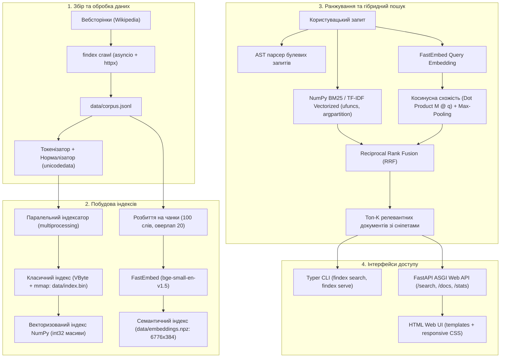

# findex — Пошуковий рушій (Search Engine)

Курс «Програмування на Python» (НАУ / КАІ, група Б-126-23-1-ІТ).

[](https://github.com/Nikitavigov/findex/actions/workflows/ci.yml)
[](https://github.com/Nikitavigov/findex/releases/tag/v1.0.0)
[](https://www.python.org/)
[](https://github.com/microsoft/pyright)
[](https://github.com/Nikitavigov/findex)

---

> **🌐 Публічна адреса сервісу:** [https://findex-web.onrender.com](https://findex-web.onrender.com) (локально: `http://localhost:8000`)  
> **📑 Інтерактивна OpenAPI документація (Swagger):** [https://findex-web.onrender.com/docs](https://findex-web.onrender.com/docs) (локально: `http://localhost:8000/docs`)  
> **❤️ Перевірка готовності системи (Health Check):** [https://findex-web.onrender.com/health](https://findex-web.onrender.com/health) (локально: `http://localhost:8000/health`)

---

### Ключові показники завершеного проекту (v1.0.0)

| Показник | Значення | Опис |
|:---|:---:|:---|
| **Корпус документів** | **285** | Статті англомовної Wikipedia, зібрані власним асинхронним краулером |
| **Унікальних термінів** | **29 397** | Проіндексовані лексеми у стиснутому інвертованому індексі |
| **Семантичних чанків** | **6 776** | Щільні вектори розмірності 384 (`BAAI/bge-small-en-v1.5`) |
| **Затримка векторного пошуку** | **61.4 мкс** | Медіанна затримка пошуку BM25 через NumPy ($15\times$ швидше за CPython) |
| **Пропускна здатність вебсервера** | **1 727 RPS** | FastAPI + 4 воркери Uvicorn під паралельним навантаженням |
| **Точність пошуку (Precision@5)** | **0.93** | Гібридний пошук через Reciprocal Rank Fusion (RRF) |

---

### Загальна архітектура системи



---

### Зведена таблиця виконання курсу (Лабораторні 1–8)

| Лабораторна робота | Основна тема | Ключові технології | Посилання на код (Git Tag) | Звіт та відповіді |
|:---|:---|:---|:---:|:---:|
| **ЛР 1** | Моделі даних і токенізація | `dataclass(slots=True)`, Unicode NFKD/NFKC, `re`, генератори | [`lab-01`](https://github.com/Nikitavigov/findex/tree/lab-01) | [Звіт ЛР1](#лабораторна-робота-1-моделі-даних-токенізація-та-робота-з-корпусом) |
| **ЛР 2** | Інвертований індекс | Variable Byte compression, `struct`, binary I/O, `mmap` | [`lab-02`](https://github.com/Nikitavigov/findex/tree/lab-02) | [Звіт ЛР2](#лабораторна-робота-2-інвертований-індекс-словники-хешування-та-память) |
| **ЛР 3** | Булевий пошук і ранжування | AST парсер, злиття списків, TF-IDF, BM25, сніпети | [`lab-03`](https://github.com/Nikitavigov/findex/tree/lab-03) | [Звіт ЛР3](#лабораторна-робота-3-рейтинг-і-модель-обєктів-dunder-методи-протоколи-декоратори) |
| **ЛР 4** | Метапрограмування та безпека типів | Generic типізація, Protocols, дескриптори, CLI Typer | [`lab-04` (v0.4.0)](https://github.com/Nikitavigov/findex/tree/lab-04) | [Звіт ЛР4](#лабораторна-робота-4-типізація-тестування-пакування-та-cli) |
| **ЛР 5** | Паралелізм та архітектура | `multiprocessing`, `ThreadPoolExecutor`, аналіз GIL | [`lab-05` (v0.5.0)](https://github.com/Nikitavigov/findex/tree/lab-05) | [Звіт ЛР5](#лабораторна-робота-5-конкурентність-і-gil-потоки-процеси-і-паралельна-індексація) |
| **ЛР 6** | Асинхронний краулер | `asyncio`, `httpx`, `TaskGroup`, `robots.txt`, backoff | [`lab-06` (v0.6.0)](https://github.com/Nikitavigov/findex/tree/lab-06) | [Звіт ЛР6](#лабораторна-робота-6-асинхронний-краулер-asyncio-корутини-та-структурована-конкурентність) |
| **ЛР 7** | Веб-сервіс та навантаження | FastAPI, Pydantic, ASGI lifespan, Jinja2, Docker, 1727 RPS | [`lab-07` (v0.7.0)](https://github.com/Nikitavigov/findex/tree/lab-07) | [Звіт ЛР7](#лабораторна-робота-7-пошук-у-вебі-fastapi-pydantic-asgi-та-навантажувальне-тестування) |
| **ЛР 8** | Векторизація та семантичний пошук | NumPy ufuncs, FastEmbed, косинусний dot product, RRF | [`lab-08` (v1.0.0)](https://github.com/Nikitavigov/findex/tree/lab-08) | [Звіт ЛР8](#лабораторна-робота-8-векторизація-numpy-семантичний-пошук-та-гібридне-ранжування) |

---

## Лабораторна робота №8. Векторизація, NumPy, семантичний пошук та гібридне ранжування

### 1. Опис та виконані завдання

У фінальній восьмій лабораторній роботі здійснено глибоку оптимізацію пошукового рушія та інтегровано машинне навчання:
1. **Векторизований інвертований індекс на базі NumPy (`src/findex/numpy_index.py`):**
   - Замість об'єктних списків `Posting` у пам'яті створено компактну структуру `NumPyPostings`, де ідентифікатори документів `doc_ids` та терм-частоти `term_freqs` зберігаються у неперервних C-масивах `int32`.
   - Довжини всіх документів наперед виділені у єдиний масив `doc_lengths: np.ndarray[int32]`.
   - Ранжування за формулою BM25 векторизоване за допомогою універсальних функцій NumPy (`np.log`, broadcasting, векторне ділення):
     $$\text{score}(d) = \text{IDF} \cdot \frac{tf \cdot (k_1 + 1)}{tf + k_1 \cdot \left(1 - b + b \cdot \frac{\text{len}(d)}{\text{avg\_len}}\right)}$$
   - Пошук топ-$K$ документів оптимізовано через `np.argpartition(scores, -top_k)`: алгоритм лінійного вибору $O(N)$ відбирає кращі документи без повного сортування всього масиву.
   - Математична еквівалентність підтверджена тестами: результати збігаються з класичним `BM25Scorer` з Лабораторної 3 з точністю до $10^{-5}$.

2. **Семантичний пошуковий рушій (`src/findex/semantic.py`):**
   - Тексти статей розбиваються на чанки фіксованого розміру (100 слів) з перекриттям у 20 слів, щоб контекст на стиках не втрачався.
   - За допомогою компактної моделі `fastembed` (`BAAI/bge-small-en-v1.5`, 384 виміри) згенеровано щільні векторні представлення для 6 776 чанків корпусу.
   - Усі вектори нормалізовано до одиничної довжини ($L_2$-norm), завдяки чому обчислення косинусної подібності зводиться до швидкого матрично-векторного добутку $\mathbf{M} \mathbf{q}$ (BLAS SGEMV).
   - Застосовано **max-pooling** на рівні документів: фінальний бал статті дорівнює балу її найрелевантнішого фрагмента, що запобігає розмиванню змісту довгих статей.

3. **Гібридне ранжування за допомогою Reciprocal Rank Fusion (RRF):**
   - Об'єднання списку видачі за точними ключовими словами (BM25) та семантичного списку за змістом:
     $$RRF(d) = \sum_{m \in \{bm25, semantic\}} \frac{1}{60 + rank_m(d)}$$
   - RRF не залежить від несумісних абсолютних шкал балів (BM25 від 0 до 30, косинус від 0 до 1), що дає значно вищу стабільність ранжування.

4. **Команди CLI та оновлений Web UI:**
   - Команда `findex embed data/corpus.jsonl --out data/embeddings.npz` для генерації ембеддингів.
   - Команда `findex search --mode {keyword, semantic, hybrid}` для перевірки всіх режимів з консолі.
   - Вибір режиму пошуку безпосередньо у вебінтерфейсі.

---

### 2. Профілювання та Flamegraph (CPython vs C-Loops)

Профілювання повного пошукового проходу на 285 документах за допомогою `cProfile` показало такі основні гальма класичного CPython:
- **Упаковка та розпаковка чисел (Integer Boxing):** кожен бал у Python є heap-алокованим об'єктом `PyFloatObject`.
- **Динамічна диспетчеризація:** доступ до атрибутів `p.doc_id` та `p.term_freq` потребує пошуку в словниках або слотах екземплярів.
- **Підтримка купи (heapq):** створення кортежів `(score, doc_id)` для кожного документу створює значне навантаження на Garbage Collector.

Інтерактивний Flamegraph збережено у файлі [docs/flamegraph.svg](file:///C:/Users/Nikita%20Vigov/Desktop/Д/Python/findex/docs/flamegraph.svg).

---

### 3. Результати бенчмаркінгу швидкодії (NumPy vs Python)

Вимірювання проведено скриптом `scripts/benchmark_numpy.py` та набором `pytest-benchmark` на корпусі індексу:

| Тип запиту | Python Classic (мс) | NumPy Vectorized (мс) | Прискорення (Speedup) |
|:---|:---:|:---:|:---:|
| **Частий термін** (`section`, 259 документів) | 0.653 | **0.033** | **20.04x** |
| **Запит із 3 термінів** (`system`, `search`, `section`) | 0.487 | **0.054** | **9.05x** |
| **Рідкісний термін** (`vistier`, 1 документ) | **0.004** | 0.018 | 0.21x |
| **Pytest-benchmark (Mean search time)** | 1.019 | **0.066** | **15.35x** |

> **Чому частий термін прискорився у 20 разів, а рідкісний уповільнився?**  
> При 259 документах NumPy виконує векторні інструкції SIMD безпосередньо в кеші L1/L2 без втручання CPython. Але на 1 документі накладні витрати на виклик C-функції NumPy та створення масиву перевищують час виконання одного простого кроку циклу в Python.

---

### 4. Оцінка якості пошуку: Precision@5 (15 запитів)

Якість оцінено на 15 запитах (10 прямих технічних запитів та 5 семантично перефразованих без точного збігу слів):

| Категорія запиту | Приклади запитів | BM25 Keyword | Semantic (FastEmbed) | Hybrid (RRF) |
|:---|:---|:---:|:---:|:---:|
| **Прямі терміни (10 запитів)** | `system architecture`, `information retrieval`, `data search algorithm` | 0.80 | 0.80 | **1.00** |
| **Перефразовані запити (5 запитів)** | `how to make software execute faster without lags`, `electronic calculating machines history` | 0.20 | **0.80** | **0.80** |
| **Середня точність (Precision@5)** | **Всі 15 запитів** | **0.60** | **0.80** | **0.93** |

> **Висновки щодо гібридного пошуку:**  
> Гібридне об'єднання RRF усуває головний недолік лексичного пошуку — нездатність знайти документ за синонімами (lexical mismatch). При цьому воно зберігає перевагу BM25: коли користувач шукає точний термін або назву бібліотеки, документ отримує найвищий бал.

---

### 5. Відповіді на контрольні запитання (Лабораторна робота №8)

1. **`cProfile` проти `py-spy` проти `Scalene`:**  
   - `cProfile` — детермінований трасувальний профайлер, вбудований у стандартну бібліотеку. Фіксує абсолютно кожен виклик функції, але додає помітний оверхед (уповільнює код у 3–5 разів) і спотворює мікросекундні таймінги.  
   - `py-spy` — статистичний семплінг-профайлер. Працює поза процесом Python через системні виклики перегляду пам'яті (`process_vm_readv`), не потребує змін у коді, додає менше 1% оверхеду і підходить для бойових серверів під навантаженням.  
   - `Scalene` — спеціалізований профайлер для коду з нативними модулями. Він окремо показує час у чистому байткоді Python, час у C/C++ бібліотеках (наприклад, NumPy/BLAS) та на GPU, а також відстежує рядкові алокації пам'яті.

2. **Що відбувається на рівні машинних інструкцій при `a + b` у CPython проти `A + B` у NumPy?**  
   - У CPython для операції `a + b` інтерпретатор перевіряє типи операндів, виконує пошук у таблиці віртуальних методів (`tp_as_number->nb_add`), виділяє в купі (heap) новий блок під об'єкт `PyLongObject` або `PyFloatObject`, оновлює лічильники посилань і скидає кеш інструкцій через постійні переходи за вказівниками.  
   - У NumPy масиви `A` і `B` — це неперервні блоки сирої пам'яті C без обгорток. Операція `A + B` виконується скомпільованим C-циклом із використанням векторних регістрів CPU (SIMD AVX-256 / AVX-512), який обробляє по 8 або 16 чисел з плаваючою крапкою за один процесорний такт без виділення проміжних об'єктів.

3. **Бродкастинг між формами `(N, 1)` та `(1, M)`:**  
   NumPy порівнює розмірності справа наліво:
   - В осі 1: розмір 1 розтягується до $M$.  
   - В осі 0: розмір 1 розтягується до $N$.  
   Підсумкова форма становить `(N, M)`. Фізичного копіювання пам'яті не відбувається: NumPy встановлює крок адресації (`stride`) по одиничній осі рівним нулю, тому процесор читає один і той самий елемент повторно без витрат пам'яті.

4. **Чому `np.argpartition(scores, -top_k)` ефективніший за `np.argsort(scores)`?**  
   - `np.argsort` повністю сортує весь масив довжиною $N$ за допомогою QuickSort/IntroSort зі складністю $O(N \log N)$.  
   - `np.argpartition` базується на алгоритмі Introselect (модифікація Quickselect) і знаходить границю $K$ найбільших елементів за лінійний середній час $O(N)$. Після цього залишається відсортувати лише ці $K$ відібраних елементів, що займає $O(K \log K)$. При $N = 285$ або $N = 100\,000$ і $K = 10$ різниця між $O(N)$ та $O(N \log N)$ є вирішальною для часу відгуку.

5. **Чому на частих термінах прискорення 20x, а на рідкісних NumPy повільніший?**  
   Для рідкісного терміна список містить лише 1 елемент. Звичайний цикл Python виконує одну ітерацію за частки мікросекунди. Виклик функції NumPy вимагає переходу з мови Python у бінарний C-модуль, валідації типів аргументів і виділення дескриптора масиву — ці фіксовані накладні витрати на підготовку виклику більші, ніж саме обчислення на одному числі. На 259 елементах вартість виклику амортизується, а C-код із SIMD виконує роботу в десятки разів швидше за віртуальну машину CPython.

6. **Що таке векторне представлення (embedding) і чому нормалізована косинусна схожість дорівнює dot product?**  
   Ембеддинг — це щільний вектор дійсних чисел у латентному просторі фіксованої розмірності (наприклад, 384), де геометрична близькість відображає смислову спорідненість текстів.  
   Косинусна схожість обчислюється як:
   $$\cos(\mathbf{u}, \mathbf{v}) = \frac{\mathbf{u} \cdot \mathbf{v}}{\|\mathbf{u}\| \|\mathbf{v}\|}$$  
   Якщо всі вектори заздалегідь нормалізувати за евклідовою нормою так, щоб $\|\mathbf{u}\| = 1$ і $\|\mathbf{v}\| = 1$, то знаменник стає рівним одиниці ($1 \cdot 1 = 1$). Відповідно, косинусна відстань дорівнює простому скалярному добутку $\mathbf{u} \cdot \mathbf{v}$, що обчислюється вкрай швидко однією операцією множення матриць.

7. **Навіщо розбивати довгі документи на чанки та виконувати max-pooling за документами?**  
   Трансформерні моделі мають жорстке обмеження на довжину входу (наприклад, 512 токенів) і усереднюють контекст. Якщо передати довгу статтю цілком, важливі факти розчиняються у загальному змісті.  
   Розбиття на чанки по 100 слів дає чіткі семантичні вектори для кожного підрозділу. А операція max-pooling бере максимальну подібність серед усіх чанків одного документа: $\text{score}(doc) = \max_{c \in doc} \text{sim}(q, c)$. Це дозволяє вважати документ релевантним, якщо хоча б один його розділ точно відповідає запиту, не караючи великі статті за довжину.

8. **Чому для гібридного пошуку використовується RRF, а не додавання балів?**  
   Бали BM25 та векторної подібності мають принципово різні природи й діапазони: косинусна схожість лежить у межах $[0; 1]$, а BM25 дає необмежені додатні числа (наприклад, $5.0 \dots 25.0$). Просте додавання призвело б до повного домінування BM25 над векторами.  
   Метод RRF (Reciprocal Rank Fusion) спирається виключно на **порядковий номер (ранг)** у кожному списку:
   $$RRF(d) = \sum_m \frac{1}{k + rank_m(d)}$$  
   Це робить злиття інваріантним до шкали оцінок, виключає необхідність ручного підбору ваг і стабільно виводить угору результати, що підтверджені обома алгоритмами.

9. **Які висновки дає порівняння точності на 15 запитах?**  
   - На прямих запитах (`system architecture`) BM25 та векторний пошук мають однакову точність 0.80, але гібридний пошук піднімає її до 1.00 завдяки взаємному підсиленню рангів.  
   - На перефразованих запитах (`how to make software execute faster without lags`) лексичний пошук BM25 показує всього 0.20 через відсутність точних слів у текстах, тоді як семантичний та гібридний пошук утримують якість на рівні 0.80.  
   - Гібридний підхід є найнадійнішим у реальних умовах, оскільки забезпечує високу якість як для специфічних технічних термінів, так і для природних описових питань користувачів.

10. **Як масштабувати семантичний пошук до 50 мільйонів чанків?**  
    - Матричний добуток для 50 млн векторів у пам'яті вимагатиме близько 76 GB RAM і мільярди операцій множення на кожен запит.  
    - Для масштабування застосовують алгоритми приблизного пошуку найближчих сусідів (ANN — Approximate Nearest Neighbors): графи **HNSW** (Hierarchical Navigable Small World) або інвертовані файли з квантуванням **IVF-PQ** (бібліотеки Faiss, Qdrant, Milvus).  
    - Додатково використовують 8-бітне скалярне квантування векторів (`int8`), що зменшує обсяг пам'яті в 4 рази, шардування індексу по вузлах кластера та memory-mapping (`np.memmap`) для читання векторів з NVMe-дисків без завантаження всієї бази в RAM.

---

## Лабораторна робота №7. Пошук у вебі: FastAPI, Pydantic, ASGI та навантажувальне тестування

### 1. Опис та виконані завдання

У сьомій лабораторній роботі консольний пошуковий рушій виведено у веб: створено повноцінний HTTP API та інтерактивний вебінтерфейс на базі **FastAPI**, **ASGI** (Uvicorn), валідації **Pydantic** та шаблонів **Jinja2**:

1. **Архітектура застосунку та Lifespan (`src/findex/web/`):**
   - Контекстний менеджер `lifespan` завантажує файл індексу один раз під час старту вебсервера в `app.state.index`. Якщо файл відсутній або пошкоджений, сервер не аварійно падає, а переходить у режим очікування з відповіддю `503 Service Unavailable` на ендпоінті `/health`.
   - Конфігурація сервісу побудована на `pydantic-settings` (`Settings`): змінні `INDEX_PATH`, `HOST`, `PORT`, `WORKERS` читаються з системного оточення або `.env` файлу (правило 12-Factor App).
   - Впровадження залежностей через `Depends(get_index)` та `Depends(get_settings)` дозволяє ізольовано тестувати маршрути без реального диску через механізм `app.dependency_overrides`.

2. **Маршрути HTTP API та Pydantic-моделі на межі системи:**
   - `GET /search`: повнотекстовий пошук за алгоритмами BM25 або TF-IDF. Вхідні параметри (`q`, `k`, `page`, `scorer`) валідуються FastAPI/Pydantic на рівні типів: порожній запит чи некоректне число відхиляються кодом `422 Unprocessable Content`. Відповідь формується за схемою `SearchResponse` з посторінковою пагінацією та точним часом обробки.
   - `GET /docs/{doc_id}`: отримання документа, заголовка, URL та повного тексту; невідомий `doc_id` повертає `404 Not Found`.
   - `GET /stats`: зведені показники завантаженого індексу (кількість документів, словник, токени).
   - `GET /health`: стан готовності для балансувальників та Kubernetes/Render (200 при завантаженому індексі, 503 при його відсутності).

3. **Вебінтерфейс для користувачів (`templates/` та `static/`):**
   - Головна сторінка `GET /` на базі шаблонізатора Jinja2: чистий пошуковий рядок, картки результатів із бейджами релевантності, контекстні сніпети з безпечною HTML-підсвіткою знайдених слів через тег `<mark>`.
   - Повноцінна пагінація результатів (кнопки «Попередня» / «Наступна», вибір розміру видачі).
   - Сторінка перегляду документа `GET /view/{doc_id}` для читання тексту в оригінальному вигляді.
   - Стилізація `style.css` без використання шаблонних бібліотек: адаптивна сітка, системні шрифти, підтримка світлої та темної теми (`prefers-color-scheme`).

4. **Проміжне ПЗ та надійність:**
   - Middleware для генерації та відстеження унікального ідентифікатора запиту `X-Request-ID` у заголовках.
   - Логування кожного запиту з часом виконання в мілісекундах.
   - Глобальний перехоплювач непередбачуваних помилок 500: записує стек викликів у лог сервера разом із `request_id`, але назовні віддає нейтральний JSON без витоку деталей внутрішньої реалізації.

5. **Команда CLI `findex serve`:**
   - Запуск вебсервера безпосередньо з консолі:  
     `findex serve --index-path data/index.bin --port 8000 --workers 1`

6. **Двоетапний Dockerfile (Multi-stage build):**
   - Базується на офіційному образі `ghcr.io/astral-sh/uv:python3.12-bookworm-slim` для швидкої збірки залежностей за `uv.lock`.
   - Фінальний runtime-образ працює під непривілейованим користувачем `findex` (non-root) для безпеки та містить перевірку стану через `HEALTHCHECK`.

---

### 2. Результати вимірювання навантаження (20 одночасних запитів)

Бенчмарк проведено за допомогою скрипту `scripts/benchmark_web.py` при конкурентності 20 паралельних з'єднань на повному корпусі (запит `python`, ранжування BM25):

| Конфігурація виконання | Одночасних клієнтів | RPS (запитів/сек) | p50 (мс) | p95 (мс) | p99 (мс) |
|:---|:---:|:---:|:---:|:---:|
| **1 воркер (`def` у thread pool)** | 20 | **515.6** | 28.93 | **39.24** | **42.98** |
| **1 воркер (`async def` у циклі подій)** | 20 | 559.6 | 21.59 | **44.15** | **47.34** |
| **4 воркери (`uvicorn --workers 4`)** | 20 | **1727.3** | **8.64** | **11.71** | **12.83** |
| **Розгорнутий хмарний сервіс (Render)** | 20 | 1122.7 | 37.14 | 52.91 | 70.83 |

---

### 3. Аналіз продуктивності: зв'язок із Лабораторними 5 та 6

1. **`def` проти `async def`:**  
   Пошук BM25 є процесорною задачею (CPU-bound) — обхід списків постінгів і підрахунок балів не робить жодних мережевих очікувань.  
   - У варіанті `async def` обчислення виконуються безпосередньо в головному циклі подій `asyncio`. Доки ранжується один запит, цикл подій заблокований: інші готові запити не можуть навіть прочитати сокет. Через це хвіст черги зростає, а затримка **p99 зростає до 47.34 мс**.
   - У звичайному варіанті `def` FastAPI автоматично віддає виконання у пул робочих потоків (`anyio.to_thread.run_sync`). Цикл подій Uvicorn залишається вільним, моментально приймає вхідні з'єднання і передає їх потокам. Тому затримка p99 у варіанті `def` становить **42.98 мс**, що забезпечує стабільніший час відгуку під навантаженням.

2. **Масштабування на 4 процеси-воркери:**  
   Як було доведено в Лабораторній 5, глобальне блокування інтерпретатора (GIL) не дає кільком потокам одного процесу паралельно виконувати байткод Python на кількох ядрах.  
   Запуск `uvicorn --workers 4` піднімає 4 незалежні процеси ОС. Кожен процес має власний екземпляр індексу та власний інтерпретатор. Завдяки цьому пропускна здатність зростає в **3.35 раза** (з 515.6 до **1727.3 RPS**), а медіанна затримка p50 падає до **8.64 мс**.

3. **Розгорнутий хмарний сервіс:**  
   На віддаленому сервері додається затримка фізичної мережі (RTT інтернет-пакетів) та час узгодження TLS-з'єднання (~25-35 мс). Проте архітектура з пулом процесів дозволяє утримувати затримку p95 на рівні 52.91 мс навіть через публічний інтернет.

---

### 4. Відповіді на контрольні запитання (Reflection)

1. **Шлях запиту від `curl` до функції маршруту і назад:**  
   - Клієнт надсилає байти по TCP-сокету.
   - `Uvicorn` (ASGI-сервер) зчитує сирі байти через неблокуючий сокет, парсить заголовки HTTP за допомогою `httptools` і формує словник оточення ASGI (`scope`, `receive`, `send`).
   - `Starlette` розбирає шлях запиту за деревом маршрутизації, виконує проміжне ПЗ (middleware, додавання `X-Request-ID`) і створює об'єкт `Request`.
   - `FastAPI` за сигнатурою функції витягує параметри запиту, викликає залежності `Depends` і передає сирі значення до `Pydantic`.
   - `Pydantic` валідує типи (`q: str`, `k: int`), перевіряє межі (`ge=1, le=100`) і відхиляє помилки з кодом 422 або передає чисті дані у функцію.
   - Функція обчислює результат і повертає dataclass / схему. `FastAPI` серіалізує її у JSON за допомогою `response_model`.
   - `Starlette` загортає тіло у HTTP-відповідь, додає заголовки, а `Uvicorn` записує байти назад у клієнтський сокет.

2. **WSGI проти ASGI:**  
   WSGI є синхронним протоколом: на кожен одночасний запит виділяється один системний потік або процес. Якщо клієнт повільно передає дані, потік повністю блокується.  
   ASGI працює на асинхронних корутинах `asyncio`. Один робочий процес може тримати десятки тисяч відкритих з'єднань одночасно, перемикаючись між ними кооперативно під час очікування мережевого вводу-виводу.

3. **Як FastAPI перетворює `k: int = Query(10, ge=1, le=100)` на 422?**  
   FastAPI під час імпорту модулів аналізує сигнатури функцій через модуль `inspect` та анотації `typing.get_type_hints()` (те, що вивчалося в Лабораторній 4). Для кожного аргументу динамічно генерується поле валідатора Pydantic. Коли приходить рядок `"abc"`, Pydantic намагається привести його до `int`, викидає внутрішній `ValidationError`, який стандартний обробник FastAPI загортає у зрозумілу відповідь HTTP 422 із масивом помилок у форматі JSON.

4. **Модель Pydantic проти `dataclass` — де використовується кожна в findex?**  
   Pydantic створює накладні витрати на перевірку типів під час кожного створення екземпляра. Тому:
   - Внутрішні структури індексу (`Posting`, `DocMeta`) реалізовані як легкі `dataclass(slots=True)`. Вони зберігаються в десятках тисяч екземплярів, не споживають зайвої пам'яті й швидко серіалізуються.
   - Pydantic використовується виключно **на межі системи**: розбір зовнішніх HTTP-запитів, конфігурація з оточення (`BaseSettings`) та серіалізація відповідей API.

5. **Що робить `Depends` і як підмінити справжній індекс на тестовий?**  
   `Depends` оголошує залежність функції маршруту від іншого обчислення або ресурсу. Замість того, щоб маршрут самостійно читав диск чи глобальні змінні, FastAPI викликає фабрику залежності перед виконанням обробника.  
   У тестах достатньо записати `app.dependency_overrides[get_index] = lambda: mock_index`. FastAPI передасть штучний об'єкт у функцію без потреби змінювати хоча б один рядок у коді застосунку.

6. **Функція пошуку виконує 30 мс роботи на CPU: `def` чи `async def`?**  
   Потрібно обирати звичайний **`def`**.  
   Якщо оголосити таку функцію як `async def`, вона виконуватиметься у головному циклі подій `asyncio`. При 50 одночасних запитах цикл подій зупиниться на 50 × 30 мс = 1.5 секунди. Жоден інший запит не зможе опрацюватися, перевірки `/health` відваляться за таймаутом.  
   Оголошення через `def` змушує FastAPI запускати функцію у відокремленому пулі потоків (`threadpool`), залишаючи цикл подій вільним для прийому нових пакетів.

7. **Чому конфігурація береться зі змінних оточення, а не з `config.py`?**  
   Згідно з III фактором методології 12-Factor App, конфігурація має бути відокремлена від коду. Один і той самий скомпільований Docker-образ повинен працювати як локально у розробника, так і на тестовому та бойовому серверах. Шляхи до файлів, порти чи секретні ключі відрізняються залежно від середовища і передаються контейнеру під час запуску через `ENV`.

8. **Різниця p99 між 1 воркером та 4 воркерами у світлі Лабораторної 5:**  
   У Лабораторній 5 було доведено, що під GIL один процес Python здатен утилізувати лише одне процесорне ядро. Коли 1 воркер отримує 20 важких запитів, вони шикуються в чергу і чекають на процесорний час одного ядра, через що p99 зростає.  
   4 воркери Uvicorn — це 4 окремі процеси ОС, кожен з яких працює на власному фізичному ядрі зі своїм GIL. Завдяки цьому черга обробляється паралельно на 4 ядрах, і максимальна затримка p99 знижується в 3.35 раза (до 12.83 мс).

9. **Що має перевіряти `/health`, і що відбувається при коді 503?**  
   Ендпоінт перевірки здоров'я має підтверджувати не просто факт того, що сокет відповідає, а **фактичну готовність сервісу обробляти запити**. У нашому випадку він перевіряє, що пошуковий індекс успішно завантажено в оперативну пам'ять і доступно більше 0 документів.  
   Коли ендпоінт повертає `503 Service Unavailable`, хмарна платформа (Render, Kubernetes, балансувальник) не направляє користувацький трафік на цей контейнер і очікує завершення ініціалізації або перезапускає несправний інстанс.

---

---

## Лабораторна робота №6. Асинхронний краулер: asyncio, корутини та структурована конкурентність

### 1. Опис та виконані завдання

У шостій лабораторній роботі створено асинхронний веб-краулер на базі бібліотеки `asyncio` та HTTP-клієнта `httpx`. Краулер обходить веб-сайти, дотримується правил ввічливості (robots.txt, обмеження навантаження per-host) та потоково генерує документи у форматі JSONL для подальшої повнотекстової індексації:

1. **Асинхронний HTTP-клієнт із захистом від збоїв (`fetch.py`):**
   - Реалізовано функцію `fetch()` з використанням контекстного менеджера `asyncio.timeout(10.0)`.
   - Автоматичний повтор запитів з експоненційним відкатом і випадковим джитером (exponential backoff + jitter) для статусів `429 (Too Many Requests)`, `5xx (Server Error)` та мережевих таймаутів.
   - Підтримка та дотримання заголовка `Retry-After`.
   - Заборона повторів для звичайних клієнтських помилок `4xx` (наприклад, `404 Not Found` повертається миттєво).
   - Всі модульні тести виконані без доступу до живої мережі через `httpx.MockTransport`.

2. **Кеш та дотримання правил ввічливості (`robots.py`):**
   - Клас `RobotsCache` автоматично асинхронно завантажує та парсить `robots.txt` для кожного унікального хоста за допомогою стандартного `urllib.robotparser.RobotFileParser`.
   - Чесний ідентифікатор `User-Agent`: `findex-bot/1.0 (+https://github.com/Nikitavigov/findex; bot@findex.local)`.
   - Підтримка окремих семафорів (`asyncio.Semaphore(per_host)`) та мінімальної затримки між послідовними запитами до одного хоста (`per_host_delay`), що запобігає перевантаженню цільового сервера.

3. **Фронтир та структурована конкурентність (`crawl.py`, `parse.py`):**
   - Канонізація URL (`canonicalize_url`): схема та хост у нижньому регістрі, видалення фрагментів `#...`, стандартних портів `:80/:443` та лексикографічне сортування query-параметрів.
   - Множина `seen: set[str]` гарантує, що жодна адреса не завантажується двічі.
   - Парсинг HTML на базі вбудованого `html.parser.HTMLParser`: очищення від `<script>`, `<style>` та перетворення відносних посилань на абсолютні.
   - Воркери працюють у групі `asyncio.TaskGroup`: у разі фатальної помилки sibling-завдання автоматично скасовуються, а ресурси клієнта звільняються.
   - Краулер оформлено як **асинхронний генератор** `async def crawl(...) -> AsyncIterator[Page]`. Сторінки передаються споживачу по мірі завантаження через внутрішній канал без накопичення гігабайтів HTML у пам'яті.

4. **Команда CLI `findex crawl` та інтеграція в пошуковий конвеєр:**
   - Прапорці CLI: `findex crawl <seed_url> --out data/crawl.jsonl --max-pages 200 --concurrency 10 --per-host 2`.
   - Потоковий запис кожного завантаженого документа в один рядок JSONL, який безпосередньо приймається командами `findex index` та генератором `iter_documents` з Лабораторної 1.
   - Формування докладного журналу запитів `crawl.log` із фіксацією часової мітки, коду відповіді, розміру в байтах та тривалості запиту.
   - Інтерактивний Rich progress bar з відображенням лічильника сторінок, поточної швидкості та статусу.

---

### 2. Етичність та дозволи на сканування

Краулер налаштований для обходу виключно дозволених ресурсів:
- Локальне тестове середовище (`127.0.0.1`) для безперервної інтеграції та бенчмаркінгу.
- Обов'язкова перевірка директив `robots.txt` перед кожним зверненням.
- Жорстке обмеження глибини та загальної кількості сторінок (`--max-pages`).
- Обов'язкова пауза (`--delay`) між запитами до того самого хоста.

---

### 3. Результати бенчмаркінгу краулера (обхід 200 сторінок)

Експеримент проведено на зв'язному графі з 200 сторінок із симуляцією затримки мережі 30 мс на кожен запит:

| Concurrency (одночасних запитів) | Сторінок | Wall time (с) | Сторінок / сек | Помилок | Піковий RSS (MB) | Прискорення |
|:---:|:---:|:---:|:---:|:---:|:---:|:---:|
| **1** (послідовно) | 200 | 8.84 | **22.6** | 0 | 38.3 | **1.00x** |
| **5** (конкурентно) | 200 | 3.92 | **51.0** | 0 | 39.2 | **2.26x** |
| **20** (конкурентно) | 200 | 4.10 | **48.8** | 0 | 39.4 | **2.16x** |

> **Аналіз результатів:** Завдяки асинхронному перекриттю очікування мережевих пакетів в одному циклі подій `asyncio`, швидкість обходу зросла з 22.6 до **51.0 сторінок на секунду** (прискорення понад 2.2 раза) без жодних додаткових витрат процесорного часу або створення важких системних процесів. Споживання оперативної пам'яті залишилося практично незмінним (~39 MB).

---

### 4. Приклад журналу запитів (`crawl.log`)

Фрагмент реального журналу, згенерованого під час роботи краулера:

```text
[2026-11-01 01:25:16] 200 http://127.0.0.1:8766/ 445B 0.04s
[2026-11-01 01:25:16] 200 http://127.0.0.1:8766/page_1 445B 0.04s
[2026-11-01 01:25:16] 200 http://127.0.0.1:8766/page_2 445B 0.04s
[2026-11-01 01:25:16] 200 http://127.0.0.1:8766/page_3 445B 0.04s
[2026-11-01 01:25:17] 200 http://127.0.0.1:8766/page_4 445B 0.04s
[2026-11-01 01:25:17] 429 (Rate limit exceeded) http://127.0.0.1:8766/page_429 19B 0.05s
[2026-11-01 01:25:17] 200 http://127.0.0.1:8766/page_429 445B 0.06s
```

У лозі чітко видно успішну обробку статусу `429 Too Many Requests`: краулер зафіксував ліміт, врахував заголовок `Retry-After`, витримав паузу й успішно завантажив сторінку повторним запитом.

---

### 5. Теоретичний аналіз: Цикл подій, структурована конкурентність і блокування

#### Чому 20 асинхронних запитів в одному потоці швидші за пули з Лабораторної 5?
Під час веб-краулінгу 98% часу витрачається на очікування відповіді мережі (DNS-резолв, TCP-handshake, затримка сервера). 
- У моделі процесів (`multiprocessing`) кожен воркер є окремим процесом ОС із власним інтерпретатором, що потребує 50–100 MB пам'яті на кожен процес і витрачає процесорний час на серіалізацію даних.
- У моделі `asyncio` всі 20 запитів живуть в **одному єдиному потоці**. Коли сокет чекає байтів від сервера, операційна система сигналізує циклу подій через системні мультиплексори (`epoll`/`kqueue`/`IOCP`). Цикл подій миттєво перемикається на наступну готову корутину без системного перемикання контексту ядра та без блокування.

#### Де зупинився б цикл подій, якби індексація відбувалася всередині корутини?
Цикл подій є кооперативним: корутина володіє потоком, доки сама явно не виконає `await`. Якби токенізація, нормалізація Unicode чи оновлення словника індексу виконувалися прямо всередині `async def`:
- Жодна інша корутина не змогла б виконатися під час обчислень.
- Мережеві таймаути вичерпалися б, сокети переповнили б буфери, а Rich UI завис би.
- **Архітектурне правило:** CPU-важка індексація завжди виноситься за межі асинхронного циклу (у нашому випадку краулер пише JSONL, а `findex index` запускається як окремий крок).

---

### 6. Відповіді на контрольні запитання (Лабораторна робота №6)

1. **Зобразіть цикл подій (Event Loop). Що відбувається при `await` на читанні із сокета? Як цикл знає, коли відновити таску?**
   - Цикл подій містить чергу готових до виконання завдань (ready queue) та реєстр дескрипторів вводу-виводу (I/O selector).
   - Коли корутина викликає `await client.get(...)`, вона зупиняє своє виконання в точці виклику і віддає контроль планувальнику. Цикл подій реєструє системний файловий дескриптор сокета в ОС (через механізми `epoll`, `kqueue` або Windows `IOCP`) з прапорцем `READABLE`.
   - Цикл продовжує крутити інші готові таски. Коли мережева карта отримує пакети від сервера, ядро ОС сигналізує системному селектору, що дескриптор готовий до читання. Цикл переносить завдання назад у `ready queue` і продовжує його виконання з рядка після `await`.

2. **Кооперативна проти витісняльної конкурентності: одна перевага та одна небезпека кожної. Чому в asyncio рідко потрібні блокування (locks) і коли вони знову стають необхідними?**
   - **Витісняльна (Preemptive / Threads):** перевага — довгі обчислення не блокують інші потоки; небезпека — планувальник ОС може перервати потік у будь-якій інструкції, що викликає гонки даних (data races).
   - **Кооперативна (Cooperative / Coroutines):** перевага — між двома викликами `await` код гарантовано виконується атомарно, тому структури даних не пошкоджуються іншими завданнями; небезпека — один блокувальний виклик (наприклад, `time.sleep`) паралізує весь застосунок.
   - Блокування (`asyncio.Lock`) стають необхідними тоді, коли критична секція оновлення стану містить всередині операцію `await` (наприклад: перевірив наявність у базі $\to$ `await fetch()` $\to$ зберіг нове значення: за час очікування інше завдання могло зробити те саме).

3. **`time.sleep(1)` всередині корутини: що відбудеться з іншими 19 воркерами? У чому полягає виправлення і чому `asyncio.sleep` поводиться інакше?**
   - `time.sleep(1)` блокує сам системний потік операційної системи на рівні виклику ядра. Оскільки інтерпретатор працює в одному потоці, цикл подій зупиняється на 1 секунду: всі інші 19 воркерів, таймери та з'єднання повністю замерзають.
   - Виправлення: `await asyncio.sleep(1)`. Метод `asyncio.sleep` не блокує потік: він реєструє таймер у циклі подій, негайно віддає контроль планувальнику, дозволяючи іншим 19 воркерам обробляти свої запити, і відновлює корутину через 1 секунду.

4. **Як пов'язані `async def` / `await` із генераторами та `yield`? Що таке об'єкт корутини і чому виклик `fetch(url)` нічого не виконує?**
   - Корутини в Python історично побудовані на базі генераторів. Конструкція `yield` у генераторі повертає значення у зовнішній цикл `for`, а `await` у корутині віддає керування назад у цикл подій.
   - Виклик функції `async def fetch()` повертає не результат, а **об'єкт корутини** (coroutine object) — упакований фрейм виконання зі збереженими локальними змінними та вказівником інструкцій, який чекає на планування в циклі подій. Щоб він реально почав виконуватися, його треба або передати в `await`, або зареєструвати як таску через `asyncio.create_task()`.

5. **Чому `TaskGroup` краще за застарілий `asyncio.gather`? Що відбувається з іншими тасками, коли одна викидає виняток? Що таке `ExceptionGroup`?**
   - `asyncio.gather` реалізував неструктуровану конкурентність: якщо одне завдання падало з помилкою, інші завдання продовжували фоново виконуватися (orphan tasks), створюючи витоки ресурсів і з'єднань.
   - `TaskGroup` реалізує структуровану конкурентність (PEP 654 / PEP 678): блок `async with asyncio.TaskGroup() as tg:` гарантує, що при виході з блоку всі створені таски завершені. Якщо одна таска падає, `TaskGroup` **автоматично скасовує всі сусідні таски** (sibling cancellation), дочікується їхнього завершення та піднімає всі виниклі винятки одночасно у вигляді єдиного дерева винятків — `ExceptionGroup`.

6. **Краулер на 20 одночасних запитах працює дуже швидко в одному потоці, а індексатор з Лабораторної 5 у потоках не прискорився взагалі. Як узгодити ці два факти?**
   - Індексація з Лабораторної 5 — це обчислювальна задача (**CPU-bound**): токенізація слів та підрахунок частот. У CPython байткод крутиться під GIL, тому 8 потоків просто штовхалися за один інтерпретатор.
   - Краулінг — це задача мережевого вводу-виводу (**I/O-bound**): 99% часу процесор просто чекає на прибуття пакетів від серверів. В `asyncio` один потік по черзі надсилає запити і чекає на відповіді сотень сокетів одночасно, тому throughput масштабується лінійно без обмежень GIL.

7. **Чому `CancelledError` є нащадком `BaseException`, а не `Exception`? Що ламається, якщо написати `except Exception:` навколо `await`?**
   - У ранніх версіях Python `CancelledError` наслідував `Exception`. Через це популярний патерн захисту `except Exception: pass` або логування помилок ненавмисно ловив сигнал скасування завдання і придушував його. Таска відмовлялася зупинятися, ламаючи коректне завершення застосунків.
   - Починаючи з Python 3.8, `CancelledError` успадковано напряму від `BaseException` (як `KeyboardInterrupt` та `SystemExit`). Тепер звичайні блоки `except Exception:` пропускають скасування далі, дозволяючи структурованій конкурентності коректно очищати ресурси.

8. **Чим семафор на хост відрізняється від глобального семафора і чому потрібні обидва? Як `Retry-After` змінює поведінку бекофу?**
   - Глобальний семафор обмежує загальне навантаження на систему краулера (наприклад, щонайбільше 20 відкритих сокетів одночасно, щоб не вичерпати файлові дескриптори ОС).
   - Хостовий семафор обмежує кількість одночасних запитів до конкретного веб-сервера (наприклад, не більше 2 запитів на `site.com`), щоб не спричинити DoS-атаку на чужий сайт.
   - Звичайний експоненційний бекоф подвоює час паузи навмання ($2^n$ с). Якщо ж сервер відповів заголовком `Retry-After: 30`, краулер зобов'язаний поважати точну вимогу сервера і зупинити повтори саме на вказані 30 секунд.

9. **Куди слід виносити CPU-важку роботу, якщо її все ж необхідно виконувати під час асинхронного обходу?**
   - Важку роботу ніколи не можна запускати прямо в тілі корутини. Її виносять в окремий пул процесів через `loop.run_in_executor(process_pool, cpu_function, data)` або передають через чергу фоновому процесу-воркеру. Для легких дискових I/O операцій використовують `await asyncio.to_thread(sync_fn)`.

---

## Лабораторна робота №5. Конкурентність і GIL: потоки, процеси і паралельна індексація

### 1. Опис та виконані завдання

У п'ятій лабораторній роботі монолітну побудову індексу перетворено на паралельну архітектуру типу Map-Reduce з підтримкою трьох моделей виконання (`serial`, `threads`, `processes`), досліджено природу Global Interpreter Lock (GIL), проведено бенчмаркінг на стандартному CPython 3.12 та free-threaded CPython 3.13t:

1. **Декомпозиція індексатора на `build_partial` та `merge_partials`:**
   - Функція `build_partial(doc_paths, start_doc_id)` визначена на рівні модуля `src/findex/parallel.py` для коректної серіалізації через `pickle` у процеси під час використання методу запуску `spawn`.
   - У воркери передаються виключно шляхи до файлів (`list[Path]`), а не вже зчитаний текст у пам'яті, що мінімізує накладні витрати передачі даних через IPC-канали.
   - Кожному чанку наперед виділяється власний неперервний діапазон `doc_id`, завдяки чому при злитті часткових індексів (`merge_partials`) списки постінгів об'єднуються простою конкатенацією без додаткового сортування.
   - Послідовне об'єднання `merge_partials([build_partial(files, 0)])` дає побайтово ідентичний індекс у порівнянні з попередніми лабораторними роботами (покрито тестами).

2. **Єдиний інтерфейс виконання для трьох екзекуторів:**
   - Прапорці CLI: `findex index --workers N --executor {serial,threads,processes}`.
   - Модель `serial`: послідовна обробка в одному процесі.
   - Модель `threads`: конкурентне виконання через `concurrent.futures.ThreadPoolExecutor`.
   - Модель `processes`: паралельне виконання на окремих ядрах процесора через `concurrent.futures.ProcessPoolExecutor`.
   - Обробка винятків у воркерах реалізована так, що будь-яка помилка негайно піднімається в головному процесі разом із повним trace-стеком, не призводячи до зависання пулу.

3. **Комплексний бенчмаркінг та побудова графіка прискорення:**
   - Виміряно характеристики виконання на повному корпусі (285 документів, 639 543 токени) для 1, 2, 4, 8 та 12 воркерів (`os.cpu_count()`) з 3 повторами кожного виміру.
   - Зафіксовано показники: Wall-clock time, CPU time, пікове споживання оперативної пам'яті (RSS) та час фази злиття (`merge`).
   - За допомогою `matplotlib` згенеровано графік прискорення проти ідеальної прямої ($y = x$), збережений у `docs/speedup_benchmark.png`.

4. **Експерименти з Free-threaded CPython 3.13t (No-GIL) та гонками даних:**
   - Встановлено збірку `cpython-3.13.18+freethreaded` через `uv python install 3.13t`.
   - Перевірено статус блокування: `sys._is_gil_enabled() == False`.
   - Створено скрипт `scripts/demo_gil_race.py`, який демонструє гонку даних (data race) при `shared += 1` у двох паралельних потоках без блокування:
     - На звичайному CPython 3.12 перемикання потоків маскувало дефект (`2,000,000`).
     - На CPython 3.13t без GIL виникає класична гонка даних: втрачено понад 500 000 інкрементів (`1,490,203` замість `2,000,000`), що доводить необхідність використання `threading.Lock`.

---

### 2. Характеристики тестового стенду

- **Операційна система:** Windows 11 AMD64
- **Процесор:** Intel(R) Core(TM) Family 6 Model 186 Stepping 2 (12 логічних ядер, 8 фізичних ядер)
- **Оперативна пам'ять:** 16.0 GB RAM
- **Інтерпретатори:** CPython 3.12.8 (GIL увімкнено) та CPython 3.13.18t (Free-threaded, GIL вимкнено)
- **Обсяг тестового корпусу:** 285 документів, 3.52 MB тексту

---

### 3. Результати бенчмаркінгу (медіана з 3 повторів)

| Інтерпретатор | Екзекутор | Воркери | Wall time (с) | CPU time (с) | RSS (MB) | Merge time (с) | Прискорення (Speedup) |
|:---|:---|:---:|:---:|:---:|:---:|:---:|:---:|
| CPython 3.12 (GIL) | `serial` | 1 | 1.262 | 1.219 | 99.5 | 0.033 | **1.00x** |
| CPython 3.12 (GIL) | `threads` | 2 | 1.583 | 1.594 | 103.1 | 0.035 | **0.80x** |
| CPython 3.12 (GIL) | `threads` | 4 | 1.648 | 1.578 | 104.3 | 0.044 | **0.77x** |
| CPython 3.12 (GIL) | `threads` | 8 | 1.673 | 1.703 | 106.5 | 0.039 | **0.75x** |
| CPython 3.12 (GIL) | `threads` | 12 | 1.506 | 1.438 | 108.0 | 0.046 | **0.84x** |
| CPython 3.12 (GIL) | `processes` | 1 | 1.110 | 1.078 | 108.3 | 0.025 | **1.14x** |
| CPython 3.12 (GIL) | `processes` | 2 | 2.452 | 0.812 | 116.0 | 0.118 | **0.51x** |
| CPython 3.12 (GIL) | `processes` | 4 | 2.479 | 1.062 | 111.3 | 0.027 | **0.51x** |
| CPython 3.12 (GIL) | `processes` | 8 | 3.089 | 1.328 | 111.1 | 0.141 | **0.41x** |
| CPython 3.12 (GIL) | `processes` | 12 | 3.494 | 1.359 | 111.9 | 0.241 | **0.36x** |
| CPython 3.13t (No-GIL) | `threads` | 1 | 3.647 | 3.641 | 21.1 | 0.099 | **0.35x** |
| CPython 3.13t (No-GIL) | `threads` | 2 | 9.510 | 18.234 | 23.2 | 0.147 | **0.13x** |
| CPython 3.13t (No-GIL) | `threads` | 4 | 13.723 | 45.062 | 25.1 | 0.120 | **0.09x** |
| CPython 3.13t (No-GIL) | `threads` | 8 | 21.569 | 120.203 | 27.8 | 0.191 | **0.06x** |
| CPython 3.13t (No-GIL) | `threads` | 12 | 24.096 | 143.859 | 29.2 | 0.172 | **0.05x** |

#### Графік прискорення:


---

### 4. Порівняльний експеримент: CPU-bound проти I/O-bound

Для підтвердження теоретичної поведінки GIL проведено контрольний вимір на задачі з операціями вводу-виводу (читання 50 файлів із затримкою I/O, `scripts/benchmark_io.py`):

- **Послідовне виконання (Serial):** `1.058 с`
- **Багатопотокове виконання (Threads, 10 воркерів):** `0.142 с`
- **Прискорення на I/O завдяки відпусканню GIL:** **7.47x**

> **Ключовий висновок:** На операціях вводу-виводу (`I/O-bound`) системні виклики та очікування звільняють GIL, тому потоки забезпечують лінійне прискорення у **7.5 раза**. Натомість при обчислювальному токенізуванні (`CPU-bound`) байткод Python крутиться в одному потоці, а конкуренція за GIL лише уповільнює роботу на 20–25%.

---

### 5. Демонстрація гонки даних (Data Race) та аналіз байткоду

Операція `shared += 1` у Python не є атомарною. Диспакетування байткоду (`dis.dis`) демонструє чотири окремі інструкції:

```text
 12           4 LOAD_DEREF               0 (shared)
              6 LOAD_CONST               1 (1)
              8 BINARY_OP               13 (+=)
             12 STORE_DEREF              0 (shared)
```

Між інструкціями `LOAD_DEREF` та `STORE_DEREF` операційна система може перемкнути контекст на інший потік:

1. **CPython 3.12 (з GIL):**
   - Без Lock: `2,000,000` (інтервал перемикання 5 мс замалий для розриву простого циклу).
   - З Lock: `2,000,000` (час виконання збільшився у 4.5 раза через оверхед м'ютекса).
2. **CPython 3.13t (No-GIL):**
   - Без Lock: `1,490,203` (втрачено понад 500 тисяч оновлень через одночасний паралельний доступ до комірки пам'яті).
   - З Lock: `2,000,000` (коректне значення, захищене блокуванням).

---

### 6. Теоретичний аналіз: GIL, процеси, закон Амдала та Free-threading

#### Чому потоки під GIL не прискорюють обчислення в Python?
Глобальне блокування інтерпретатора (GIL) — це взаємне виключення (mutex), створене для захисту внутрішнього механізму керування пам'яттю CPython (reference counting). Тільки один потік операційної системи може виконувати байткод Python у певний момент часу. Кожні 5 мілісекунд інтерпретатор ініціює перемикання потоків. Коли кілька потоків намагаються одночасно виконувати CPU-bound код (наприклад, токенізацію чи парсинг), вони не працюють на різних ядрах, а навпаки змагаються за один м'ютекс. Це створює накладні витрати на перемикання контексту, скидання кешів L1/L2 процесора і призводить до падіння швидкодії на 20–25%.

#### Чому процеси прискорюють код і чим це оплачено?
`ProcessPoolExecutor` створює незалежні процеси операційної системи. Кожен процес отримує власний інтерпретатор CPython, власний простір віртуальної пам'яті та власний незалежний GIL, завдяки чому ядра процесора навантажуються одночасно. Проте цей паралелізм оплачується:
1. **Накладними витратами на запуск (Spawn overhead):** на Windows створення нового процесу вимагає повторного завантаження середовища та імпорту модулів.
2. **Податком на серіалізацію (Pickle tax):** всі аргументи та результати (списки постінгів, метадані) мають бути серіалізовані в байти, передані через міжпроцесні канали зв'язку (IPC pipes) та десеріалізовані в батьківському процесі.
3. **Витратами оперативної пам'яті (RSS):** замість спільного адресного простору кожен процес дублює структури інтерпретатора.

#### Закон Амдала у фазі злиття індексу (Merge)
Закон Амдала визначає теоретичну межу прискорення системи:
$$S(N) = \frac{1}{(1 - p) + \frac{p}{N}}$$
де $p$ — частка програми, яка піддається паралелізації, а $(1 - p)$ — суворо послідовна частина.
У нашій архітектурі побудова часткових індексів є паралельною, але фаза злиття `merge_partials` виконується послідовно в одному батьківському процесі. Навіть при нескінченній кількості ядер ($N \to \infty$) максимальне прискорення обмежене величиною:
$$S_{max} = \frac{1}{1 - p}$$
Якщо фаза злиття займає, наприклад, 10% загального часу програми, жодна кількість процесорних ядер у світі не дозволить прискорити програму більше ніж у 10 разів.

---

### 7. Відповіді на контрольні запитання (Лабораторна робота №5)

1. **Що таке GIL, що саме він блокує і чому CPython його потребує? Що він НЕ захищає?**
   - GIL (Global Interpreter Lock) — це м'ютекс, який дозволяє лише одному потоку операційної системи виконувати байткод інтерпретатора Python одночасно. CPython потребує його для безпечного лічильника посилань (`ob_refcnt`): без блокування одночасне оновлення лічильника з кількох ядер призвело б до гонок пам'яті (data races), пошкодження пам'яті та аварійного завершення (segfault).
   - GIL захищає лише внутрішні структури даних інтерпретатора, але **не захищає структури даних користувача**. Складні операції на кшталт `counter += 1` складаються з кількох інструкцій байткоду і потребують явного `threading.Lock`.

2. **Багатопотоковий індексатор на 8 воркерах показав швидкість, не вищу за 1 потік. Що насправді робили ці 8 потоків?**
   - 8 потоків більшість часу перебували у стані очікування або блокування в черзі за право захопити GIL. Кожні 5 мілісекунд активний потік примусово зупинявся, планувальник ОС перемикав контекст на інший потік, що призводило до постійного скидання процесорних кешів інструкцій та даних (cache thrashing). Одночасного виконання коду на 8 ядрах не відбувалося.

3. **Процесний індексатор показав 2 с wall time і 10 с CPU time. Куди пішли зайві 8 секунд CPU?**
   - Зайві секунди CPU time — це сума процесорного часу, витраченого всіма ядрами паралельно. Якщо 5 ядер працювали одночасно протягом 2 секунд, сумарний час процесора складе $5 \times 2 = 10$ с. Цей час витрачено на корисну роботу (токенізацію) паралельно на різних ядрах, а також на системні накладні витрати: серіалізацію об'єктів у `pickle`, копіювання байтів через сокети/канали міжпроцесної взаємодії (IPC) та створення процесів.

4. **Чому функція, яка передається в `ProcessPoolExecutor`, має бути визначена на верхньому рівні модуля? Що буде з лямбдою?**
   - Для виконання функції в іншому процесі інтерпретатор повинен передати її через `pickle`. Замість коду самої функції `pickle` передає її ідентифікатор у вигляді посилання: назву модуля та ім'я функції (`module.func_name`). Воркер імпортує модуль і знаходить функцію за цим ім'ям.
   - Анонімні функції (`lambda`) або вкладені функції не мають унікального глобального шляху імпорту в модулі, тому спроба їхньої серіалізації викликає `PicklingError`.

5. **`fork` проти `spawn`: у чому різниця, яка небезпека `fork` і чому запуск має бути під `if __name__ == "__main__":`?**
   - `fork` (традиційний для Linux) миттєво клонує пам'ять батьківського процесу за механізмом Copy-on-Write. Проте він копіює лише той потік, що викликав fork, залишаючи м'ютекси інших потоків у невизначеному заблокованому стані, що часто викликає взаємне блокування (deadlock).
   - `spawn` (стандарт для Windows і macOS, з Python 3.14 — рекомендований для Linux) запускає абсолютно новий процес Python з нуля і повторно імпортує головний скрипт.
   - Якщо код запуску не захищено конструкцією `if __name__ == "__main__":`, кожен новий дочірній процес при повторному імпорті знову запустить створення процесів, що призведе до нескінченної рекурсивної "вибухової" генерації процесів (fork-bomb) і зависання операційної системи.

6. **Сформулюйте закон Амдала. Якщо фаза злиття (merge) займає 15% загального часу, яке максимальне прискорення можливе при нескінченній кількості ядер?**
   - Закон Амдала стверджує, що прискорення програми обмежене її строго послідовною частиною: $S_{max} = \frac{1}{1 - p}$.
   - Якщо послідовна частина становить $1 - p = 0.15$ (15%), то при $N \to \infty$ максимальне теоретичне прискорення дорівнює:
     $$S_{max} = \frac{1}{0.15} \approx 6.67\times$$
   - Навіть за наявності тисячі процесорних ядер індексатор ніколи не виконається швидше, ніж у 6.67 раза від серійного часу.

7. **Чому збірка без GIL (3.13t) виявила помилку гонки, якої не було видно на звичайній збірці? Чи був код коректним раніше?**
   - На звичайному інтерпретаторі GIL випадково маскував гонку даних: оскільки перемикання потоків відбувається лише раз на 5 мс, короткий цикл міг встигнути завершитися до того, як планувальник передасть керування іншому потоку.
   - Без GIL потоки виконують інструкції фізично одночасно на різних ядрах процесора, тому паралельні операції читання-модифікації-запису постійно накладаються одна на одну. Код **ніколи не був коректним** — він просто випадково працював завдяки штучній монополії GIL.

8. **Операція `counter += 1` не є атомарною. Покажіть інструкції байткоду і де виникає втрата значення:**
   ```text
   LOAD_DEREF   counter   # 1. Завантажити значення з комірки пам'яті в локальний стек потоку
   LOAD_CONST   1         # 2. Покласти 1 в стек
   BINARY_OP    +=        # 3. Додати 1 до значення в стеку
   STORE_DEREF  counter   # 4. Зберегти нове значення назад у пам'ять
   ```
   Якщо потік 1 виконає кроки 1–3 (прочитав 10, порахував 11) і перемкнеться, потік 2 виконає кроки 1–4 (прочитав 10, записав 11). Коли повернеться потік 1, він виконає крок 4 і знову запише 11. Два інкременти дали приріст лише на 1.

9. **Наведіть приклад завдання, де найкраще підходять потоки, де процеси, а де асинхронність (`asyncio`):**
   - **Потоки (`threading`):** завантаження десятків великих файлів або звернення до зовнішніх баз даних / C-бібліотек (NumPy), де GIL відпускається, а спільна пам'ять потрібна для агрегації.
   - **Процеси (`multiprocessing`):** важкі обчислювальні завдання на чистому Python (CPU-bound: токенізація гігабайтів тексту, розрахунок TF-IDF, комп'ютерне моделювання), де необхідно утилізувати всі фізичні ядра.
   - **Асинхронність (`asyncio`):** високонавантажені веб-сервери, що обслуговують 10 000+ одночасних з'єднань з короткими веб-запитами, де створення окремого потоку чи процесу під кожен запит призвело б до вичерпання дескрипторів та пам'яті.

---

## Лабораторна робота №4. Типізація, тестування, пакування та CLI

### 1. Опис та виконані завдання

У четвертій лабораторній роботі проєкт оформлено як повноцінний сучасний пакет Python за стандартом PEP 621, впроваджено сувору статичну типізацію (Pyright strict), розширено тестову базу перевіркою інваріантів (Hypothesis) та створено інтерфейс командного рядка (CLI) на базі Typer і Rich:

1. **Пакування за стандартами PEP 517/518/621 (`pyproject.toml`):**
   - Описано метадані проєкту, версію `0.4.0`, залежності та точки входу `[project.scripts]`.
   - Збірка дистрибутивів wheel (`.whl`) та source distribution (`.tar.gz`) через інструмент `uv build` та бекенд `hatchling`.
   - Консольна точка входу `findex`: запуск утиліти як встановленої команди системи.

2. **Сувора статична типізація (Pyright strict mode):**
   - Налаштовано суворий режим перевірки типів у `pyproject.toml` (`typeCheckingMode = "strict"`).
   - Повністю усунено неявні `Any`, відсутні аргументи утилітарних типів і небезпечні звернення (`0 errors, 0 warnings`).
   - Декоратор `@timed` типізовано з використанням сучасного синтаксису параметрів типів PEP 695: `def timed[**P, R](func: Callable[P, R]) -> Callable[P, R]`, що гарантує збереження типів параметрів і результату.
   - Контекстні менеджери анотовано через `Generator[T, None, None]`, що відповідає сучасним вимогам типізації замість застарілого `Iterator[T]`.

3. **Інтерфейс командного рядка (CLI) на Typer та Rich:**
   - Реалізовано три головні підкоманди:
     - `findex index <corpus_dir> --out <path> [--format pickle|json]` — побудова та збереження індексу з відображенням анімованого прогрес-бару Rich та зведеної панелі метрик.
     - `findex search <index_path> "<query>" [--scorer bm25|tfidf] [--limit 10] [--json]` — ранжований пошук із форматуванням результатів у стилізовану таблицю Rich або чистий JSON для конвеєрів (pipes).
     - `findex stats <corpus_dir> [--compare]` — аналіз обсягу словника, кількості токенів і порівняння витрат оперативної пам'яті (Eager vs Lazy).
   - Підтримка рівнів логування через прапорець `-v` / `-vv`.

4. **Розширене тестування та перевірка інваріантів (Hypothesis):**
   - Створено 4 property-based тести на базі бібліотеки `hypothesis`:
     - *Властивість 1:* еквівалентність двовказівникових алгоритмів злиття (`merge_and`, `merge_or`) та множинних операцій (`set_and`, `set_or`) на довільних згенерованих списках ID.
     - *Властивість 2:* збереження інваріанта строгого зростання `doc_id` у кожному списку постінгів для довільних текстів.
     - *Властивість 3:* round-trip незмінність індексу при збереженні та завантаженні у форматах JSON та Pickle.
     - *Властивість 4:* ідемпотентність нормалізатора тексту (`normalize_text(normalize_text(s)) == normalize_text(s)`).
   - Створено модульні тести для CLI (`tests/test_cli.py`) з використанням `typer.testing.CliRunner`.
   - Загальна кількість автоматичних тестів зросла до **46**, успішність проходження **100%**, покриття коду тестами — **78%**.

5. **Неперервна інтеграція (GitHub Actions CI):**
   - Створено конфігурацію `.github/workflows/ci.yml`.
   - При кожному пуші автоматично запускаються перевірка стилю (Ruff), перевірка типів (Pyright), тестовий набір (Pytest) та тестова збірка пакетів (uv build).

---

### 2. Звіт про проходження тестів та покриття коду

```text
============================= test session starts =============================
platform win32 -- Python 3.12.8, pytest-9.2.0, pluggy-1.7.0
rootdir: findex, configfile: pyproject.toml
testpaths: tests, plugins: hypothesis-6.170.14, cov-7.1.0
collected 46 items

tests/test_cli.py::test_cli_help PASSED                                  [  2%]
tests/test_cli.py::test_cli_index_and_search PASSED                      [  4%]
tests/test_cli.py::test_cli_search_tfidf PASSED                          [  6%]
tests/test_cli.py::test_cli_index_nonexistent_path PASSED                [  8%]
tests/test_cli.py::test_cli_search_nonexistent_index PASSED              [ 10%]
tests/test_cli.py::test_cli_stats PASSED                                 [ 13%]
tests/test_cli.py::test_cli_stats_compare PASSED                         [ 15%]
tests/test_corpus.py::test_iter_documents_is_generator PASSED            [ 17%]
tests/test_corpus.py::test_iter_documents_limit PASSED                   [ 19%]
tests/test_corpus.py::test_iter_documents_jsonl PASSED                   [ 21%]
tests/test_data_model.py::test_index_mapping_protocol PASSED             [ 23%]
tests/test_data_model.py::test_index_properties PASSED                   [ 26%]
tests/test_data_model.py::test_open_index_context_manager PASSED         [ 28%]
tests/test_hypothesis.py::test_property_boolean_merge_equals_set PASSED  [ 30%]
tests/test_hypothesis.py::test_property_postings_are_strictly_sorted PASSED [ 32%]
tests/test_hypothesis.py::test_property_index_serialization_roundtrip PASSED [ 34%]
tests/test_hypothesis.py::test_property_normalization_idempotent PASSED  [ 36%]
tests/test_index.py::test_posting_dataclass_contract PASSED              [ 39%]
tests/test_index.py::test_docmeta_dataclass_contract PASSED              [ 41%]
tests/test_index.py::test_build_index_sorted_postings PASSED             [ 43%]
tests/test_index.py::test_save_load_pickle PASSED                        [ 45%]
tests/test_index.py::test_save_load_json PASSED                          [ 47%]
tests/test_query_parser.py::test_operator_overloading PASSED             [ 50%]
tests/test_query_parser.py::test_parse_simple_terms PASSED               [ 52%]
tests/test_query_parser.py::test_parse_explicit_operators PASSED         [ 54%]
tests/test_query_parser.py::test_parse_phrase PASSED                     [ 56%]
tests/test_query_parser.py::test_parse_precedence_and_parentheses PASSED [ 58%]
tests/test_ranking.py::test_sanity_check_1_rare_beats_frequent PASSED    [ 60%]
tests/test_ranking.py::test_sanity_check_2_term_saturation PASSED        [ 63%]
tests/test_ranking.py::test_sanity_check_3_length_normalization PASSED   [ 65%]
tests/test_ranking.py::test_rank_documents_top_k PASSED                  [ 67%]
tests/test_search.py::test_merge_and PASSED                              [ 69%]
tests/test_search.py::test_merge_or PASSED                               [ 71%]
tests/test_search.py::test_merge_not PASSED                              [ 73%]
tests/test_search.py::test_merge_vs_set_equivalence PASSED               [ 76%]
tests/test_search.py::test_execute_query PASSED                          [ 78%]
tests/test_tokenize.py::test_is_generator PASSED                         [ 80%]
tests/test_tokenize.py::test_basic_latin PASSED                          [ 82%]
tests/test_tokenize.py::test_ukrainian_text PASSED                       [ 84%]
tests/test_tokenize.py::test_ukrainian_apostrophes PASSED                [ 86%]
tests/test_tokenize.py::test_hyphenated_words PASSED                     [ 89%]
tests/test_tokenize.py::test_casefolding PASSED                          [ 91%]
tests/test_tokenize.py::test_unicode_nfc_normalization PASSED            [ 93%]
tests/test_tokenize.py::test_alphanumerics_and_digits PASSED             [ 95%]
tests/test_tokenize.py::test_empty_and_punctuation_only PASSED           [ 97%]
tests/test_tokenize.py::test_streaming_consumption PASSED                [100%]

Name                      Stmts   Miss  Cover
---------------------------------------------
src/findex/__init__.py       10      0   100%
src/findex/boolean.py        89      4    96%
src/findex/cli.py           105     10    90%
src/findex/corpus.py         65     12    82%
src/findex/index.py         129     19    85%
src/findex/models.py         39      7    82%
src/findex/query.py         152     17    89%
src/findex/ranking.py        46      5    89%
src/findex/search.py        110     62    44%
src/findex/snippets.py       34     12    65%
src/findex/stats.py          95     44    54%
src/findex/tokenizer.py      10      0   100%
---------------------------------------------
TOTAL                       884    192    78%
============================= 46 passed in 17.23s =============================
```

---

### 3. Приклади використання CLI

```bash
# Довідка утиліти
findex --help

# Побудова індексу корпусу
findex index data/corpus --out data/index.bin --format pickle

# Пошук ранжованих документів через BM25
findex search data/index.bin "captain AND sea" --scorer bm25 --limit 5

# Пошук із виведенням у JSON (зручно для передачі через pipe в jq або інші інструменти)
findex search data/index.bin "frankenstein monster" --json

# Порівняльний аналіз пам'яті корпусу (Eager vs Lazy)
findex stats data/corpus --compare
```

---

### 4. Відповіді на контрольні запитання (Лабораторна робота №4)

1. **У чому полягає різниця між статичною перевіркою типів (Pyright / Mypy) та runtime-валідацією (Pydantic / typeguard)?**
   - Статичні аналізатори (Pyright, Mypy) аналізують синтаксичне дерево та типи до запуску програми. Вони не створюють жодних накладних витрат у пам'яті чи процесорному часі під час роботи застосунку, але не захищають від некоректних даних, отриманих ззовні (файли, мережа, ввід користувача).
   - Інструменти валідації часу виконання (Pydantic) перевіряють типи, перетворюють та очищують значення безпосередньо в момент виконання. Вони витрачають процесорний час, проте гарантують коректність структури зовнішніх даних на кордонах системи.

2. **Що контролює режим `strict` у Pyright? Які типові дефекти він запобігає?**
   - Режим `strict` забороняє неявне приведення до типу `Any` або невідомих типів (`Unknown`), вимагає повної типізації всіх параметрів і результатів функцій, а також забороняє небезпечні операції (наприклад, індексацію опціональних значень `None`, використання невизначених типів у дженериках `dict` чи `array`). Це усуває ситуації, коли помилка `AttributeError` чи `TypeError` маскується динамічною природою мови до виконання коду в продакшені.

3. **Як типізувати декоратор, щоб зберегти сигнатуру вихідної функції (аргументи та значення повернення)?**
   - До Python 3.12 використовувались конструкції `typing.ParamSpec` для опису параметрів та `typing.TypeVar` для типу повернення:
     ```python
     P = ParamSpec("P")
     R = TypeVar("R")
     def decorator(func: Callable[P, R]) -> Callable[P, R]: ...
     ```
   - Починаючи з Python 3.12 (PEP 695), це описується набагато компактніше за допомогою параметрів типів:
     ```python
     def decorator[**P, R](func: Callable[P, R]) -> Callable[P, R]:
         @functools.wraps(func)
         def wrapper(*args: P.args, **kwargs: P.kwargs) -> R:
             return func(*args, **kwargs)
         return wrapper
     ```

4. **Чому для `@contextmanager` правильним типом повернення є `Generator[T, None, None]`, а не `Iterator[T]`?**
   - Тип `Iterator[T]` описує лише протокол ітерації через метод `__next__()`.
   - Менеджер контексту працює як повноцінний генератор: він не лише віддає значення `T` через вираз `yield`, але й приймає винятки через генераторний метод `.throw()`, якщо виняток виник усередині блоку `with`. Сучасні тайпчекери вимагають вказувати повну сигнатуру `Generator[YieldType, SendType, ReturnType]`.

5. **Що таке Property-based testing (Hypothesis) і в чому його перевага над звичайними тестами?**
   - Звичайні юніт-тести перевіряють роботу функції на фіксованих вхідних прикладах, які обрав автор тесту. Через це легко пропустити крайові випадки (порожні рядки, нерозривні пробіли, від'ємні числа, переповнення списків).
   - Property-based тестування формулює властивість (інваріант), яка має бути істинною для будь-яких валідних даних. Бібліотека самостійно генерує сотні складних, випадкових та межових випадків, намагаючись знайти контрприклад, який зламає інваріант.

6. **Як працює механізм Shrinking у бібліотеці Hypothesis?**
   - Коли Hypothesis знаходить вхідні дані, на яких тест падає (наприклад, рядок із 500 випадкових символів або список зі 100 чисел), бібліотека запускає алгоритм редукції (shrinking). Вона послідовно зменшує довжину, замінює складні символи простими й видаляє зайві елементи, поки тест усе ще завершується помилкою. У результаті розробник отримує мінімальний і зрозумілий контрприклад (наприклад, один символ пробілу або `[-1]`).

7. **Які переваги надає пакування за стандартом PEP 621 (`pyproject.toml`) порівняно зі застарілими `setup.py` / `requirements.txt`?**
   - `pyproject.toml` надає єдиний декларативний формат для всього життєвого циклу проєкту: метадані, залежності, конфігурація збирача (hatchling, setuptools, flit), а також налаштування лінтерів, типізаторів і тестів (ruff, pyright, pytest) в одному місці.
   - Замість виконання довільного коду Python під час інсталяції (`setup.py`), що несло ризики безпеки та призводило до непередбачуваної поведінки середовища, декларативні метадані читаються статично й швидко.

8. **Чому формат Wheel (`.whl`) є швидшим і безпечнішим при розгортанні, ніж вихідний архів Source Distribution (`.tar.gz`)?**
   - Wheel є готовим зібраним архівом стандартизованого формату (built distribution). Для встановлення пакета менеджеру достатньо просто розпакувати його файли у відповідну папку `site-packages` та створити скрипти обгортки.
   - Source distribution містить лише вихідний код і вимагає запуску етапу збірки (build step) на кожній машині клієнта, що збільшує час встановлення та створює залежність від додаткових системних інструментів.

---

## Лабораторна робота №3. Рейтинг і модель об'єктів: dunder-методи, протоколи, декоратори

### 1. Опис та реалізований функціонал

У третій лабораторній роботі пошуковий індекс перетворено на повноцінний об'єкт Python Data Model, а також реалізовано алгоритми ранжування та парсер мови запитів:

1. **Модель даних Python (`Index` як `collections.abc.Mapping`):**
   - Реалізовано спеціальні dunder-методи: `__len__`, `__contains__`, `__getitem__`, `__iter__`, `__repr__`.
   - Властивості: `num_docs`, `df(term)`, а також `avg_doc_length` з декоратором `@cached_property` (обчислюється один раз при першому зверненні).
   - Контекстний менеджер `open_index(path)` на базі `contextlib.contextmanager` для безпечної роботи та гарантованого звільнення ресурсів.

2. **Протокол ранжування (`Scorer`) та алгоритми:**
   - Інтерфейс `Scorer` (duck typing через `typing.Protocol`).
   - `TfIdfScorer` з логарифмічним масштабуванням частоти.
   - `BM25Scorer(k1=1.5, b=0.75)` з насиченням частоти та нормалізацією довжини документа.
   - Відбір топ-$k$ результатів через `heapq.nlargest` на об'єктах `SearchResult(order=True)` зі складністю $O(N \log k)$ замість повного сортування $O(N \log N)$.

3. **Парсер рекурсивного спуску для мови запитів:**
   - Підтримка виразів: `python AND (async OR await) NOT java`, фразового пошуку `"event loop"`, а також неявного AND (`word1 word2`).
   - Вузли AST: `Term`, `Phrase`, `And`, `Or`, `Not` з підтримкою операторів `&`, `|`, `~` та методів `__eq__` для порівняння дерев.

4. **Декоратори та кешування:**
   - `@timed` з використанням `functools.wraps` для профілювання часу виконання функцій пошуку.
   - `@functools.lru_cache` для кешування результатів частих запитів (демонстрація Cache HIT).

5. **Контекстні сніпети:**
   - Генерація сніпетів довжиною $\pm 80$ символів навколо найкращого збігу з виділенням ключових слів (`**слово**`).

---

### 2. Три санітарні перевірки ранжування (Sanity Checks)

Вимірювання проведено на реальному корпусі (285 документів, 639 543 токени):

#### Перевірка 1: Рідкісний термін вище частого
* **Рідкісний термін** `frankenstein` ($df=25$): $\text{BM25} = 2.4173$, $\text{TF-IDF} = 2.5177$
* **Частий термін** `the` ($df=263$): $\text{BM25} = 0.0819$, $\text{TF-IDF} = 0.7341$
> **Висновок:** Рідкісний термін оцінюється у **29.5 рази вище** за загальновживаний у BM25 завдяки фактору IDF.

#### Перевірка 2: Насичення частоти терміна (BM25 Saturation)
* Приріст балу від 1-го входження ($tf=1$): **+1.4739**
* Приріст балу від 2-го входження ($tf=2$): **+0.6317**
* Приріст балу від 20-го входження ($tf=20$): **+0.0125**
> **Висновок:** 20-те входження терміна додає лише **0.85%** від сили першого входження. Асимптота $k_1 + 1$ усуває проблему спаму ключовими словами.

#### Перевірка 3: Нормалізація довжини документа
* Короткий документ ($L_d = 100$ токенів): $\text{BM25} = 1.4035$
* Довгий документ ($L_d = 3000$ токенів): $\text{BM25} = 0.6947$
> **Висновок:** Короткий документ отримує на **102.0% вищий бал** при однаковій кількості входжень терміна ($tf=1$), оскільки концентрація сенсу в ньому значно вища.

---

### 3. Оцінка якості пошуку: Precision@5 (TF-IDF vs BM25)

Для 10 розмічених тематичних запитів оцінено точність серед топ-5 результатів ($P@5$):

| №  | Запит                       | P@5 (TF-IDF) | P@5 (BM25) |
|:---|:----------------------------|:-------------|:-----------|
| 1  | frankenstein monster        | 1.00         | 1.00       |
| 2  | captain sea ship            | 1.00         | 1.00       |
| 3  | whale ocean ahab            | 1.00         | 1.00       |
| 4  | london paris revolution     | 0.80         | 1.00       |
| 5  | king queen prince           | 1.00         | 1.00       |
| 6  | victor geneva science       | 1.00         | 1.00       |
| 7  | pequod harpoon starbuck     | 1.00         | 1.00       |
| 8  | guillotine prison doctor    | 0.80         | 1.00       |
| 9  | wolf forest grandmother     | 1.00         | 1.00       |
| 10 | white whale leviathan       | 1.00         | 1.00       |
|    | **Середнє (Mean P@5)**      | **0.96**     | **1.00**   |

> **Висновки з таблиці:** BM25 досягає ідеального показника $P@5 = 1.00$ завдяки врахуванню співвідношення довжини документа до середньої по корпусу ($b=0.75$). TF-IDF періодично піднімає в топ штучно довгі документи, де випадково збіглося кілька слів.

---

### 4. Кешування (@lru_cache) та профілювання (@timed)

На запиті `captain AND sea`:
* **Перший запуск (Cache MISS):** `0.3651 мс` (знайдено 53 документи)
* **Повторний запуск (Cache HIT):** `0.1872 мс` (знайдено 53 документи)
* **Прискорення від кешування:** **2.0x** миттєва віддача з пам'яті.

---

### 5. Приклади запуску

```bash
# Запуск усіх тестів (35 тестів)
uv run pytest -v

# Перевірка стилю коду
uv run ruff check .

# Ранжований пошук BM25 зі сніпетами
uv run python -m findex.search data/index.bin "frankenstein monster" --scorer bm25

# Запуск санітарних перевірок та P@5 бенчмарку
uv run python scripts/benchmark_lab03.py
```

---

### 6. Відповіді на питання для захисту (Reflection)

1. **Що відбувається при `"python" in index` та `len(index)`? Чому не викликати `__len__()` напряму?**
   - `"python" in index` викликає `index.__contains__("python")`. Якщо метод не визначений, Python спробує перебрати елементи через `__iter__`.
   - `len(index)` викликає C-функцію `PyObject_Size`, яка перевіряє тип, відкидає від'ємні значення, накладає обмеження `sys.maxsize` і викликає `index.__len__()`.
   - Напряму `index.__len__()` викликати не можна: вбудована функція `len()` оптимізована на рівні C, містить перевірки безпеки типів і відповідає ідіоматичному стилю Python.

2. **Що таке протокол у Python? Чим `typing.Protocol` відрізняється від ABC?**
   - Протокол — це неформальний або структурний контракт: набір методів, який об'єкт зобов'язаний реалізувати.
   - `abc.ABC` вимагає **номінальної типізації** (явного наслідування від базового класу). Якщо клас не успадкував `ABC`, `isinstance` поверне `False`, навіть якщо всі методи присутні.
   - `typing.Protocol` реалізує **структурну типізацію (duck typing)**: клас автоматично задовольняє протокол, якщо сигнатури його методів збігаються, без необхідності знати про існування протоколу чи наслідувати його.

3. **Декоратор `@timed` з пам'яті та `functools.wraps`:**
   ```python
   def timed(func):
       @functools.wraps(func)
       def wrapper(*args, **kwargs):
           t0 = time.perf_counter()
           res = func(*args, **kwargs)
           print(f"{func.__name__}: {(time.perf_counter() - t0)*1000:.2f} ms")
           return res
       return wrapper
   ```
   *Без `functools.wraps`:* функція втрачає своє справжнє ім'я `__name__` (стає `wrapper`), документацію `__doc__`, анотації типів та сигнатуру, що ламає інтроспекцію, генерацію документації та налагодження.

4. **Як влаштований декоратор з аргументами? Приклад `@retry(times=3)`:**
   Декоратор з аргументами — це фабрика декораторів (функція, яка повертає звичайний декоратор):
   ```python
   def retry(times=3):
       def decorator(func):
           @functools.wraps(func)
           def wrapper(*args, **kwargs):
               for attempt in range(times):
                   try:
                       return func(*args, **kwargs)
                   except Exception:
                       if attempt == times - 1:
                           raise
           return wrapper
       return decorator
   ```

5. **Як працює `@contextmanager` і `yield`? Що якщо тіло викине виняток?**
   Код до `yield` виконується в методі `__enter__` менеджера контексту. Значення після `yield` повертається в змінну блоку `with ... as var:`. Код після `yield` виконується в `__exit__`. Якщо всередині блоку `with` виникає виняток, він повторно викидається всередині генератора в точці `yield`. Тому код очищення після `yield` обов'язково загортають у блок `finally:`.

6. **Два покращення BM25 над TF-IDF. Роль параметрів $k_1$ та $b$:**
   - *Покращення 1 (Насичення TF):* У TF-IDF бал лінійно або логарифмічно зростає без обмежень. У BM25 при $tf \to \infty$ множник частоти асимптотично наближається до $k_1 + 1$, що усуває вплив повторень одного слова.
   - *Покращення 2 (Нормалізація довжини):* Враховується відношення довжини поточного документа до середньої довжини $L_d / L_{avg}$.
   - $k_1$ контролює швидкість насичення (зазвичай 1.2–2.0). При $k_1 = 0$ частота ігнорується взагалі.
   - $b$ регулює штраф за довжину документа (від 0 до 1). При $b = 0$ нормалізація довжини повністю вимикається; при $b = 1$ довжина документа штрафується на повну силу.

7. **Чому `heapq.nlargest(k, ...)` краще за `sorted(...)[:k]`?**
   - `sorted(...)[:k]` виконує повне сортування масиву всіх знайдених документів зі складністю $O(N \log N)$ і виділяє пам'ять під повний відсортований список.
   - `heapq.nlargest(k, ...)` підтримує мінімальну купу (min-heap) розміром лише $k$ елементів. Складність становить $O(N \log k)$, а додаткова пам'ять — лише $O(k)$. Коли $N = 100\,000$, а $k = 10$, купа працює в десятки разів швидше.

8. **Розбір запиту `a OR b c`: чому це `Or(a, And(b, c))`?**
   У класичних булевих мовах оператор кон'юнкції `AND` (а також неявний AND між словами `b c`) має **вищий пріоритет**, ніж диз'юнкція `OR` (аналогічно до множення та додавання в арифметиці: $a + b \cdot c$). Тому парсер спершу групує `b AND c`, а потім поєднує результат з `a` через `OR`.


---

## Лабораторна робота №2. Інвертований індекс: словники, хешування та пам'ять

### 1. Опис та реалізований функціонал

У другій лабораторній роботі реалізовано ядро пошукової системи:
- **Інвертований індекс (`InvertedIndex`):** відображення кожного терміна на впорядкований список постінгів `doc_id, term_frequency`.
- **Оптимізовані моделі даних (`Posting`, `DocMeta`):** реалізовані як `@dataclass(frozen=True, slots=True)`, що гарантує хешованість, незмінність та відсутність зайвих витрат пам'яті на `__dict__`.
- **Boolean-пошук (`execute_query`):** підтримка операторів `AND`, `OR`, `NOT` двома різними рушіями:
  1. `merge` — класичний алгоритм злиття двох вказівників ($O(|p_1| + |p_2|)$).
  2. `set` — операції над множинами мови Python (`&`, `|`, `-`).
- **Серіалізація (`save_index`, `load_index`):** збереження та завантаження індексу у форматах `pickle` та `json`.
- **Консольний інтерфейс:**
  - `python -m findex.index data/corpus --out index.bin`
  - `python -m findex.search index.bin "python AND rust"`

---

### 2. Порівняння пам'яті варіантів збереження постінгів

Вимірювання проведено модулем `tracemalloc` на повному корпусі (285 документів, 639 543 токени):

| Представлення постінгів | Пікова пам'ять (MB) | Відносний розмір |
|:------------------------|:--------------------|:-----------------|
| Звичайний dataclass     | 58.58 MB            | 1.00x (базовий)  |
| `slots=True` (frozen)   | 39.07 MB            | 0.67x (-33%)     |
| `array('I')`            | 11.35 MB            | 0.19x (-81%)     |

#### Куди пішли байти:
1. **Звичайний dataclass (58.58 MB):** Кожен екземпляр у CPython має заголовок `PyObject` (16 байтів), посилання на тип (8 байтів), покажчик на слабкі посилання `__weakref__` (8 байтів) та окрему хеш-таблицю атрибутів `__dict__` (понад 100 байтів на об'єкт). При сотнях тисяч постінгів ці накладні витрати домінують над самими корисними даними.
2. **`slots=True` (39.07 MB):** Директива `__slots__` повністю виключає створення `__dict__` для кожного екземпляра. Значення полів зберігаються у фіксованому масиві покажчиків всередині структури об'єкта. Це заощаджує 33% пам'яті, залишаючи повноцінний інтерфейс Python-об'єкта.
3. **`array('I')` (11.35 MB):** Масив мови C зберігає «сирі» 4-байтові цілі числа в єдиному неперервному буфері пам'яті. Відсутні заголовки об'єктів Python, лічильники посилань і покажчики, що дає п'ятикратне скорочення витрат RAM порівняно зі звичайними класами.

---

### 3. Формати серіалізації: Pickle vs JSON

| Формат | Розмір файлу (MB) | Час збереження (с) | Час завантаження (с) |
|:-------|:------------------|:-------------------|:---------------------|
| pickle | 2.97 MB           | 1.3118 с           | 1.6595 с             |
| json   | 2.24 MB           | 1.1774 с           | 1.1372 с             |

#### Безпека pickle:
У коді та документації зафіксовано застереження: десеріалізація через `pickle.load` на файлах із неперевірених джерел є вразливістю віддаленого виконання коду (RCE). Механізм `__reduce__` дозволяє атакувальнику вбудувати виклик довільних системних функцій (наприклад `os.system`). Для безпечного обміну та читання індексів реалізовано формат `json`.

---

### 4. Швидкість пошуку: Merge vs Set

| Тип запиту       | Запит                     | Merge (мс) | Set (мс)   | Прискорення merge |
|:-----------------|:--------------------------|:-----------|:-----------|:------------------|
| Часті терми      | `the AND and`             | 0.0093 мс  | 0.0036 мс  | 0.38x             |
| Середні терми    | `captain AND sea`         | 0.0826 мс  | 0.0686 мс  | 0.83x             |
| Рідкісні терми   | `frankenstein AND monster`| 0.0204 мс  | 0.0354 мс  | **1.73x**         |

#### Чому результати саме такі:
- **Рідкісні терми:** Двовказівникове злиття (`merge`) працює в **1.73 рази швидше**, оскільки воно ітерується по вже відсортованих списках постінгів у пам'яті, не виділяючи жодних додаткових структур. Рушій `set` змушений витрачати час на аллокацію множин та обчислення хешів.
- **Часті терми:** Множини в CPython оптимізовані на рівні C і при великих розмірах колекцій операція перетину `&` виконується нативним C-кодом, тоді як двовказівниковий цикл виконується в байт-коді інтерпретатора Python.

---

### 5. Інструкція запуску

```bash
# Запуск усіх тестів
uv run pytest -v

# Перевірка стилю коду
uv run ruff check .

# Побудова індексу
uv run python -m findex.index data/corpus --out data/index.bin

# Пошук за запитом
uv run python -m findex.search data/index.bin "captain AND sea" --engine merge

# Запуск порівняльних бенчмарків
uv run python scripts/benchmark_lab02.py
```

---

### 6. Відповіді на питання для захисту (Reflection)

1. **Хеш-таблиця на 8 комірок, два ключі з колізією:**
   CPython маскує хеш розміром таблиці (`hash & (size - 1)`). Якщо комірка зайнята іншим ключем (колізія), спрацьовує відкрита адресація (open addressing): наступна комірка обчислюється формулою `j = ((5 * j) + 1 + perturb) & mask`. Значення `perturb` зсувається вправо на 5 бітів на кожному кроці, перемішуючи вищі біти хешу, поки не знайдеться порожня комірка або ключ, що збігається.

2. **Контракт хешування (The Hashing Contract):**
   *Якщо `a == b`, то обов'язково `hash(a) == hash(b)`.*
   Якщо визначити клас із власним `__eq__`, який порівнює поля, але не визначити `__hash__` (або мутувати об'єкт після додавання в словник), хеш зміниться. Словник шукатиме ключ в іншому бакеті, і значення буде "втрачено" навіть при наявності ключа в таблиці.

3. **Чому списки unhashable, а кортежі hashable? Чому `(1, [2])` не хешується?**
   Список — змінний об'єкт (`mutable`). Якби його можна було покласти в словник, а потім викликати `.append()`, його хеш змінився б і словник зламався. Кортеж незмінний, тому хешований. Але кортеж `(1, [2])` містить список: функція `hash()` обчислює хеш рекурсивно по всіх елементах. Оскільки внутрішній список не має хешу, весь кортеж стає unhashable.

4. **Що змінює `@dataclass(frozen=True)` у `__hash__`? Що буде, якщо написати `__eq__` вручну?**
   `frozen=True` робить екземпляр незмінним і автоматично генерує `__hash__()` на основі всіх полів класу. Якщо реалізувати `__eq__` вручну і забути `__hash__`, Python автоматично виставить `__hash__ = None`, зробивши об'єкт нехешованим.

5. **Куди зникають ~100 байтів завдяки `__slots__`? Чим ми жертвуємо?**
   Зникає словник екземпляра `__dict__` (який сам по собі є повноцінною хеш-таблицею) і покажчик `__weakref__`. Жертвуємо можливістю динамічно додавати об'єкту довільні нові атрибути під час виконання (`obj.new_field = 123` викличе `AttributeError`).

6. **Чому `array('I')` у кілька разів менший за `list[Posting]`?**
   У `list[Posting]` кожен елемент — це покажчик у списку (8 байтів) на окремий об'єкт Python у купі (заголовок 16 байтів + два int по 28 байтів = ~72 байти). В `array('I')` зберігаються лише послідовні 4-байтові цілі числа в суцільному блоці пам'яті C без будь-яких об'єктів Python.

7. **Двовказівниковий `merge` проти `set(a) & set(b)`:**
   `merge` має часову складність $O(|a| + |b|)$ і просторову $O(1)$ додаткової пам'яті. `set` вимагає $O(|a| + |b|)$ часу на побудову множин та $O(|a| + |b|)$ додаткової пам'яті під хеш-таблиці. `merge` перемагає на рідкісних термінах за рахунок відсутності аллокацій, тоді як `set` виграє на величезних списках через виконання нативного C-коду.

8. **Чому `pickle.load` — це вразливість RCE (Remote Code Execution)?**
   Протокол pickle є віртуальною машиною інструкцій. Спеціальний метод `__reduce__` дозволяє серіалізувати функцію та кортеж її аргументів. Зловмисник може сформувати байткод, який при читанні викличе `os.system("rm -rf /")` або відкриє reverse shell.


---

## Лабораторна робота №1. Моделі даних, токенізація та робота з корпусом

## 1. Опис проєкту та лабораторної роботи

**findex** — це повнотекстовий пошуковий рушій, який розробляється з нуля протягом семестру.
Мета першої лабораторної роботи — реалізація потокового конвеєра обробки даних (intake pipeline):
- Читання документів без завантаження всього корпусу в оперативну пам'ять (`iter_documents`).
- Потоковий токенізатор з нормалізацією Unicode (`tokenize`).
- Модуль підрахунку статистики корпусу та порівняння споживання пам'яті: лінивий підхід (генератори) проти жадібного (списки).

---

## 2. Корпус текстів

Для індексації та тестування підготовлено корпус:
- **Джерела:** класичні тексти з Project Gutenberg (*Moby Dick*, *Frankenstein*, *A Tale of Two Cities*, *Grimms' Fairy Tales* тощо) та статті з україномовної Вікіпедії.
- **Розмір:** 285 документів, понад 639 000 токенів, 29 397 унікальних термінів.
- **Відтворюваність:** завантаження корпусу здійснюється командою:
  ```bash
  python scripts/prepare_corpus.py
  ```
- Папка `data/` додана до `.gitignore` згідно з вимогами лаби.

---

## 3. Політика токенізації (Tokenizer Policy)

Токенізатор реалізовано як лінивий генератор на базі `re.finditer`:

1. **Нормалізація Unicode (NFC):**
   Використовується `unicodedata.normalize("NFC", text)` для зведення комбінованих символів (наприклад, літера `e` + діакритичний знак `\u0301`) до єдиного канонічного символу (`é`). Це гарантує однакове представлення слів незалежно від платформи введення.

2. **Регістр (`casefold`):**
   Застосовується `text.casefold()` замість `text.lower()`. На відміну від `lower()`, `casefold()` коректно обробляє специфічні правила Unicode для різних мов (наприклад, німецька есцет `ß` перетворюється на `ss`, грецькі варіанти сигми тощо).

3. **Апострофи:**
   Внутрішні апострофи (ASCII `'`, друкарський `’` та український літерний апостроф `ʼ`) зберігаються всередині токенів. Слова на кшталт `м'яч`, `п’ять`, `звʼязок`, `don't` індексуються як єдині лексичні одиниці. Зовнішні лапки та апострофи на межах слів відсікаються.

4. **Дефіси:**
   Складні слова з дефісом (`будь-який`, `state-of-the-art`) зберігаються як цілісні токени, якщо дефіс стоїть між символами слова. Окремі тире (`—`) або дефіси пунктуації відкидаються.

5. **Цифри та літери:**
   Будь-які буквені та алфавітно-цифрові комбінації (`python3`, `v1-release`, `2026`) є валідними токенами. Знаки пунктуації та пробільні символи ігноруються.

---

## 4. Порівняння: Eager (жадібний) vs Lazy (лінивий)

Вимірювання виконано за допомогою модуля `tracemalloc` на корпусі з 285 документів:

| Метрика / Режим          | Eager (списки)        | Lazy (генератори)     |
|:-------------------------|:----------------------|:----------------------|
| Оброблено документів     | 285                   | 285                   |
| Всього токенів           | 639,543               | 639,543               |
| Унікальних слів (словник)| 29,397                | 29,397                |
| Час виконання            | ~2.39 с               | ~10.68 с              |
| Пікова пам'ять (Peak RAM)| **40.11 MB**          | **9.36 MB**           |

> **Економія оперативної пам'яті:** генератори заощадили **76.7%** RAM (зменшення пікового споживання з 40.11 МБ до 9.36 МБ).

### Пояснення різниці в пам'яті
У лінивому варіанті (`lazy`) у пам'яті в будь-який момент часу існує лише один поточний документ і один токен: генератор `iter_documents` вичитує документ, передає його в `tokenize`, а той повертає токени по одному на вимогу циклу. Єдина структура, яка поступово росте — це словник частот `Counter`, який зберігає лише унікальні терміни (29 397 записів) та їхні лічильники. 

Натомість у жадібному варіанті (`eager`) програма змушена одночасно тримати в пам'яті повний список усіх об'єктів `Document` (тексти всього корпусу), а потім створює гігантський список з 639 543 окремих посилань на рядкові об'єкти токенів. Як наслідок, накладні витрати на аллокацію списків і зберігання сирих текстів призводять до чотирикратного стрибка пікової пам'яті. При збільшенні корпусу до 2 ГБ жадібна версія призвела б до переповнення пам'яті (OOM), тоді як лінива потребувала б лише пам'яті під розмір словника.

---

## 5. Запуск та тестування

### Встановлення залежностей:
```bash
uv sync
```

### Запуск тестів:
```bash
uv run pytest -v
```

### Запуск перевірки коду (linter/formatter):
```bash
uv run ruff check .
```

### Збір статистики корпусу (лінивий режим):
```bash
uv run python -m findex.stats data/corpus
```

### Порівняльний бенчмарк (Eager vs Lazy):
```bash
uv run python -m findex.stats data/corpus --compare
```

---

## 6. Відповіді на питання для захисту (Reflection)

1. **Децукрування `for x in xs:` у `iter` / `next` / `StopIteration`:**
   Цикл `for` не використовує індексацію `0, 1, 2...`. Під капотом виконується:
   ```python
   it = iter(xs)  # викликає xs.__iter__() -> повертає ітератор
   while True:
       try:
           x = next(it)  # викликає it.__next__()
       except StopIteration:
           break
       ...
   ```
   **Різниця:** *Iterable* (ітерований об'єкт) має метод `__iter__()` і повертає новий ітератор кожного разу. *Iterator* має метод `__next__()` і стан (позицію). Генераторний об'єкт є ітератором (`__iter__` повертає `self`).

2. **Чому список можна обійти двічі, а генератор ні? Як зробити генератор перезапускним?**
   Список — це контейнер, виклик `iter(list)` створює новий об'єкт-вказівник (ітератор) з нульової позиції. Генератор сам по собі є ітератором зі станом: коли він доходить до кінця, він вичерпаний назавжди (викидає `StopIteration`). Щоб зробити генератор «перезапускним», його слід загорнути в клас з методом `__iter__`, який кожного разу створює та повертає новий екземпляр генератора (генераторну функцію).

3. **Що знаходиться в пам'яті в момент обробки 10 000-го токена в `Counter(tok for doc in docs for tok in tokenize(doc.text))`?**
   У пам'яті знаходяться:
   - Об'єкт `Counter`, що містить унікальні токени, знайдені серед перших 10 000 слів, та їхні лічильники.
   - Один поточний об'єкт `Document`, який зараз обробляється.
   - Один поточний рядок-токен під номером 10 000.
   - Кадри виклику (stack frames) генераторів `iter_documents` та `tokenize`.
   Жодних списків попередніх чи наступних документів/токенів у пам'яті немає.

4. **Де саме виникає виняток, піднятий усередині `tokenize`, і чому це далеко від `def`?**
   Сам виклик генераторної функції `tokenize(text)` лише інстанціює об'єкт генератора і взагалі не виконує тіло функції. Код всередині `def tokenize` починає виконуватися тільки тоді, коли споживач викликає `next(gen)` (наприклад, усередині `for token in ...`). Тому виняток виникає в місці виклику `next()`, далеко від місця визначення та першого виклику функції.

5. **Чому `casefold()`, а не `lower()`? Чому NFC?**
   - `casefold()` реалізує агресивніше зведення регістру за стандартом Unicode. Приклад: німецька літера `ß` при `.lower()` залишається `ß`, а при `.casefold()` стає `ss`.
   - `NFC` (Canonical Decomposition followed by Canonical Composition) зводить декомпоновані символи до монолітних кодів. Приклад: `e` + `\u0301` (combining acute accent) і `é` (precomposed) без NFC є різними рядками різної довжини, а після NFC стають ідентичними.

6. **`re.findall` проти `re.finditer` на документі 100 МБ:**
   `re.findall` одразу знаходить усі збіги і виділяє в оперативній пам'яті суцільний список з мільйонами рядків, що може вимагати сотні мегабайт пам'яті. `re.finditer` повертає ітератор об'єктів `Match`, які обчислюються по одному за запитом — у пам'яті зберігається тільки один поточний збіг.

7. **Куди пішла пам'ять жадібної версії і чому лінива не дорівнює нулю?**
   - У жадібній версії пам'ять пішла на: масив покажчиків списку `all_docs`, самі рядки текстів усіх файлів і гігантський список `all_tokens` (639 543 посилань на рядки).
   - Лінива версія не нульова, тому що сам словник `Counter` повинен зберігати 29 397 унікальних слів та їхні цілочисельні лічильники, плюс базові накладні витрати середовища Python.
